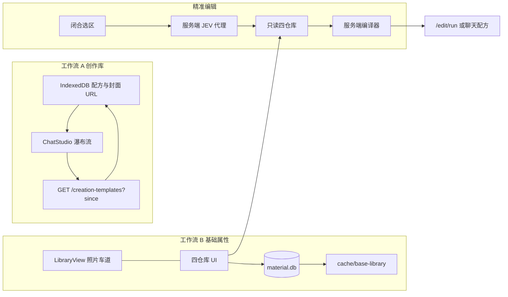
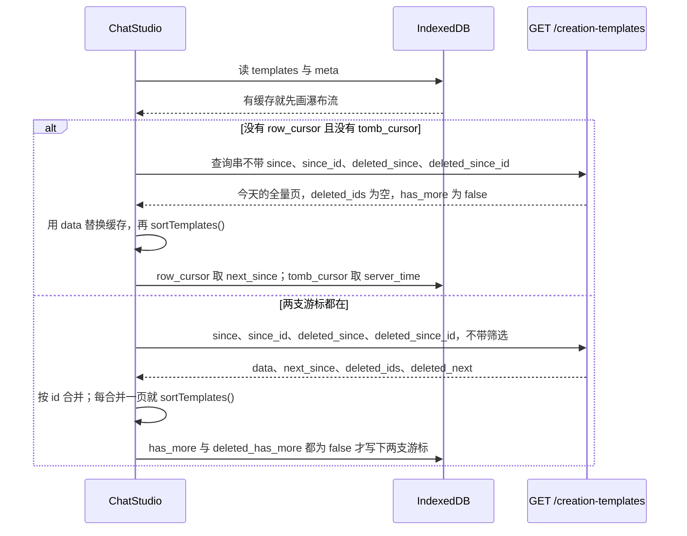
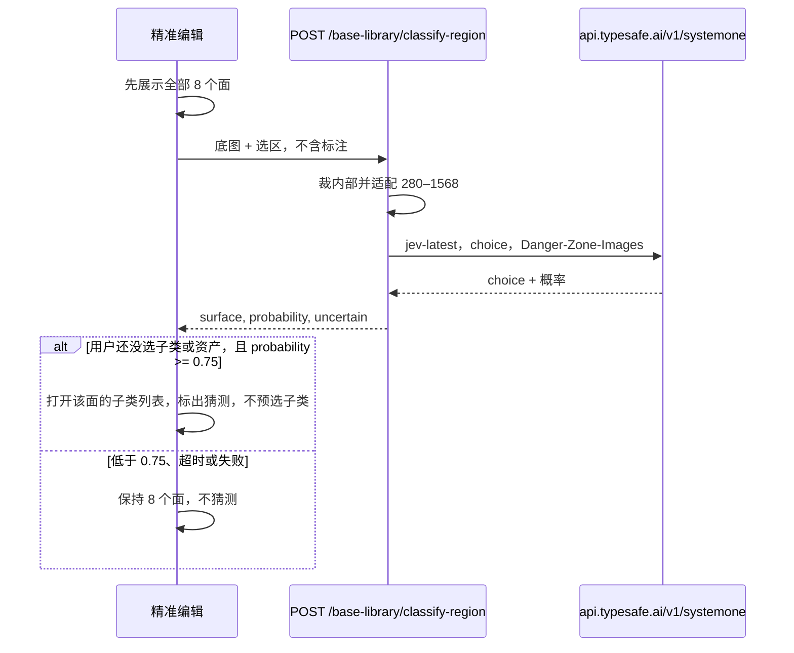

# 灵感创作资产库与基础属性库

| 项 | 值 |
| --- | --- |
| 作者 | （待填） |
| 日期 | 2026-10-28 |
| 状态 | Draft |
| 范围 | `MaterialLibraryServer` 的空间创作（ChatStudio + QuickStudio）与照片 DAM 旁的基础属性库 |

## 概述

这是两条互不替代的工作流。

**A. 灵感创作资产库**只改创作配方网格的呈现和同步。卡片按资产真实画幅做瀑布流，9:16 是高卡片，预览井不再锁死 16:9。浏览器先画本地缓存的配方列表和海报/封面 URL，再增量合并新增、更新和删除。行的 `since` 与墓碑的 `deleted_since` 是两支游标，不能合成一个 `max(updated_at, deleted_at)`。视频和大图只在卡片进入视口或被打开时加载，网格里不再为每张卡挂 `<video controls>`。这条库不是基础属性库。

**B. 基础属性库**是精准编辑读取的参考资产仓库。口诀：8 个装修面是货架标签；材质、色号、灯具、模型是四个仓库；场景绑定是底图上的价签，不是第五个仓库。纹理只进材质库。替换只改价签上的资产 id，不复制文件。JEV 只在精准编辑里、用户闭合选区之后跑一次，把裁切分到 8 个装修面之一，用来决定能改哪些面板；它不负责组织库。库是编辑器读取的参考资产集合。

两条线可以分开上线。创作库的瀑布流和增量同步不依赖色号镜像。

## 背景与动机

### 创作库现在的代价

创作库网格在 `web-pro/src/views/studio/ChatStudio.vue`。卡片预览井是固定的 `aspect-video`，图片和视频都是 `object-cover`（约 1508–1541 行）。9:16 的成片被裁成 16:9 横条。`loadTemplates()`（约 4014–4025 行）对 `GET /api/creation-templates` 的返回值整表替换 `templates`。

服务端在 `src/api.js` 的 `GET /creation-templates`（约 3233–3325 行）：`SELECT * … ORDER BY is_pinned DESC, use_count DESC, updated_at DESC LIMIT 1000`，没有 `since`。行里已有 `updated_at`（毫秒，`Date.now()`）。`DELETE /creation-templates/:id`（约 3430–3440 行）是物理删除，不留墓碑，客户端无法从增量响应里知道「这张卡没了」。视频分支直接挂 `<video controls>`，一百张卡就是一百个解码器。

`handleApi` 同时服务于 `server.js` 的 `/api` 和插件前缀，新路由仍写在 `src/api.js` 这一处。

### 基础属性现在的代价

全屏图像编辑器是 `web-pro/src/views/studio/StudioEditLayer.vue`。`recolor` 的界面文案是「基础属性」（约 1055–1064、1180 行）。芯片来自 `web-pro/src/utils/material-presets.js` 的 `MATERIAL_CATEGORIES`、`INTERIOR_COLOR_PALETTES`、`FINISH_OPTIONS`、`AGING_OPTIONS`。`selectPresetMaterial()`（约 1710–1728 行）把 6 个写死的 SVG（`/textures/travertine_stone.svg` 等）塞进 `params.materialTextureUrl`。`openMaterialLibraryPicker()` 打开的是 `AssetPickerModal`（约 1599–1610 行），`context="edit"`，标题写着「从 DAM 素材库挑选」。本地上传则把 `FileReader` 的 data URL 直接写上选区（约 1781–1789 行）。配方句由客户端 `buildBaseAttributesRecipe()` 拼出，`buildAggregatedRecipeLines()`（约 3115–3188 行）在 `executeUnifiedApply()` 前使用它。

`web-pro/src/views/studio/QuickStudio.vue` 的 `studioMode` 是 `precision | global`（约 1165 行）。精准模式的六个键是 `editModes`：`replace`、`install`、`add`、`gap`、`remove`、`expand`（约 1648–1655 行）。全局模式的 `globalModes` 只有 `upscale`、`style`、`watermark`（约 2029–2033 行）。扩图并不在全局抽屉里，而在精准模式的 `selectedMode === 'expand'`，以及 `StudioEditLayer` 的外绘。聊天侧全局配方在 `web-pro/src/views/studio/StudioGlobalDrawer.vue`，三个页签是风格、超分、去水印（约 40–77 行），`writeStyleRecipe()` 把句子写进配方。

照片 DAM 在 `web-pro/src/views/LibraryView.vue`。`SOURCE_PLATES` 是原素材、精修素材、成品素材、剪辑素材、回收站（约 1314–1322 行）。这三路照片车道保持不动，基础属性库加在它们旁边，不替换它们。

已有的 `color_schemes`（`scripts/migrate.js` 约 844 行）是整屋配色方案，不是色号库。`product_presets`（约 768 行）是带 GLB 的软装预置，不是本版模型库。两者都不复用。

### 服务端已经怎么存东西

数据目录是 `ML_DATA_DIR`，否则 `~/.dsh-material-library`（`server.js` 约 18 行）。目录是 SQLite `material.db` 加 `cache/{thumbs,derivatives,originals,preview,temp}`。`src/derivatives.js` 的 `createDerivative()` 把文件写到 `cache/derivatives/` 下的相对路径，行里记 `storage_type='local_cache'` 和 `storage_ref`。目录表（`creation_templates`、`presets`、`color_schemes`、`product_presets`）都是 SQL，不是一棵 `meta.json`。迁移入口是 `scripts/migrate.js`；热路径上 `src/api.js` 的 `schemaCheckedOnce()` 会再补一次 DDL。图像处理已经用 `sharp`。

因此本版不把 `materials/{大类}/{子类}/{id}/meta.json` 当事实来源。一条胡桃木要同时挂「地面-木地板、墙面-护墙、全屋定制-柜门」，单路径目录会强迫复制文件，和「替换只改价签」相反。事实来源是 `material.db` 里的行；磁盘上只有允许的那一类文件。

### 已有的视觉调用，和 JEV 不是一条路

预填中文名用现成的 `src/vlm.js`：`chatVision()` / `chatVisionOnce()`。`src/handlers/region-vlm.js` 的 `describeRegion()` 和 `POST /ai/vlm-describe`（`src/api.js` 约 4150–4177 行）都是这条路：`gen-governance` 的 `resolveVlmEndpoint()` 取 `baseUrl` 和 `apiKey`，图片转成 base64，不让模型去抓公网 URL。`chatVision()` 只在模型名是 `workflow_vision` 且遇到池满时才走 `VISION_FALLBACK_CHAIN`。

JEV 不走 LiteLLM，也不走 `describeRegion()`。`describeRegion()` 会把选区外扩约 90%（`cropNeighborhood()`，`src/handlers/image-ops.js` 约 374–428 行，长边最多 2048），那是给「这是什么家具」用的。装修面分类要的是选区内部，短边抬到 280、长边不超过 1568，并且不能带标注线。

## 目标与非目标

### 目标

- 创作库卡片按真实画幅排，视口外不挂视频、不拉大图；打开时先画缓存再增量合并，删除能消下去。
- 照片 DAM 旁增加四个入口：材质库、色号库、灯具库、模型库。装修面是资产上的筛选标签，不是根导航。一条资产一行，可挂多个装修面/子类。
- 精准编辑（`StudioEditLayer` 的基础属性路径，以及 QuickStudio `studioMode==='precision'`）闭合选区后，由服务端代理做一次 JEV 八选一。编辑器挑选器只读这四个仓库。
- 全局编辑不加 JEV、不开材质货架；在现有风格/超分/扩图/去水印旁边增加整图光线控制。一次执行可以有多条选区价签，外加一条整图光线子句。
- 价签写在底图上。图像编辑每个选区最多一张参考图：色号色块或 1K 底色。法线、粗糙度、金属度、AO、IES、GLB 本版不下载、不发送。

### 非目标

- 不替换原素材 / 精修素材 / 成品素材，不把创作库并进基础属性库。
- 不用 JEV 给库打标、不做子类自动选中、不做第二次子类调用。
- 不做 `scenes/{project}/bindings` BIM 档案，不复制资产字节到项目目录。
- 不把织物做成第五个仓库。`fabric_id` 就是材质库里带织物标签的 `material_id`。
- 不抓取建E网、嘉乐秀图、立邦/多乐士中国官网、ColorTell、兆材、Material Bank、NCS、Pantone、IES-Library、3DTexel、厂商壁纸站。理由见安全一节的「不抓取」表。
- 灯具库没有 IES、没有灯具文件。模型库入口在，内容为空，文案写明这一版不替换模型。
- 不给 TypeSafe 图像接口假定生产 SLA。官方把图像题标成 prototype（Dreamer-ready）。

## 方案

### 总览



口诀对应的数据所有权：

| 概念 | 是什么 | 不是什么 |
| --- | --- | --- |
| 8 装修面 | 资产上的标签，也是编辑器面板的分组 | 库的根导航；JEV 的编目结果 |
| A 材质 | 仓库。只存一张 1K 底色 | PBR 套装 |
| B 色号 | 仓库。PaintDB 元数据 + 本地色块 | 中国官网色卡、ColorTell |
| C 灯具 | 仓库。五档光向 + 色温预设，无文件 | IES / 灯具模型 |
| D 模型 | 仓库入口。表是空的 | `product_presets` 的 GLB |
| E 价签 | 写在这张底图上的资产 id、光向、色温 | 第五个仓库；文件副本 |

### A. 创作库

#### 画幅

去掉卡片井上的 `aspect-video`。井的 `aspect-ratio` 按这个顺序取：

1. `poster_w` 与 `poster_h` 都已有正数时，用 `poster_w / poster_h`。这时即使 `aspect_ratio` 仍是列默认 `'16:9'`（`src/api.js` 约 3249 行），也信任像素尺寸，不再把井打成 1:1。
2. 否则解析 `aspect_ratio`。只有值不是列默认 `'16:9'` 时才用它（例如客户端明确写入的 `9:16`）。默认 `'16:9'` 和「作者真的要 16:9」在库里无法区分，所以在 `poster_w` 仍为空时，这口井先用 `1 / 1`，禁止再锁死 `aspect-video`。
3. 图片海报解码后读 `naturalWidth` / `naturalHeight`。视频没有海报时，第一次挂上 `<video>`（进入视口或打开详情）读 `videoWidth` / `videoHeight`，用这个比例改本地井。
4. 回写：仅当当前用户是该行属主或管理员，且服务端 `poster_w` 仍为 NULL，才 `PATCH` `aspect_ratio`、`poster_w`、`poster_h`。今天的 UPDATE（约 3407 行）不写这三列，PR2 要补上，并且只在 `poster_w IS NULL` 时写入，避免每次打开都改 `updated_at`。非属主得到 SEC-007 的 403（约 3385 行）：只改这一会话里的井，把 id 记在内存集合里，不再重试。403 不推进本地 `updated_at`。

容器从现在的等行 `grid-cols-*` 改为 CSS 多列瀑布流：`column-width: 240px`，卡片 `break-inside: avoid`，宽度 100%。井的比例已经等于资产时，`object-cover` 不会再把竖图裁成横图；实现时用 `object-cover` 填满这个真实比例的井即可。角标（置顶、模态、画幅）仍绝对定位在卡片内。

#### 浏览器缓存

不用 `localStorage`。`ChatStudio.vue` 已把 `localStorage` 用于草稿，并注明它不是响应式源、换登录后旧的 `/<video>` 仍带着旧 token（约 3626 行）。一千条配方加上提示词，也容易顶满约 5MB 的 `localStorage`。

使用 IndexedDB：

- 库名 `mls-creation-library`
- 对象库 `templates`，`keyPath: id`
- 对象库 `meta`，存 `{ row_cursor, tomb_cursor, userId }`。`row_cursor` 是 `{ updated_at, id }`，`tomb_cursor` 是 `{ deleted_at, id }`。不要存裸毫秒，也不要再存一个合并后的 `cursor`。

每条存复用配方和画卡片需要的整份列表字段，而不是一张海报：

- 标量：`id`、`updated_at`、`title`、`prompt`、`type`、`aspect_ratio`、`poster_w`、`poster_h`、`space`、`style`、`purpose`、`is_pinned`、`use_count`、`tags`、`channel`。
- `params`：原样对象。`applyTemplate()`（`ChatStudio.vue` 约 4254 行）读取 `genMode`、`modelKey`、`schemaMode`、`schemaParams`。
- `origin_images[]` 与 `result_images[]`：去掉 token 查询串后的 URL，保留 `fid`。卡片和详情（约 1294、1515 行）用 `result_images[0]` 和原图画中画；`applyTemplate()` 对带 `fid` 的原图走 `resignAssetUrl()` / `getAssetImageUrl()`。

渲染时再走 `authedMediaUrl()`。不存视频字节。

登出或 `sessionTick` 变化时丢掉这份缓存再拉。API 今天的 GET 并不按 `user_id` 过滤（任何登录用户看到同一份列表），但媒体 URL 是会话相关的，换人必须重签。

打开顺序：



合并是幂等的：同 id 以后到的 `updated_at` 更大者为准；`deleted_ids` 从内存和 IDB 删除。禁止再写 `templates.value = json.data`。每次合并进 `templates` 之后、画网格之前，调用现有的 `sortTemplates()`（`ChatStudio.vue` 约 2832 行；今天的调用点在 `loadTemplates()` 约 4021 行）。比较器不变：`is_pinned` 降序，`use_count` 降序，`updated_at` 降序。增量页按 `updated_at ASC` 到达，不调用这个函数就会停在到达顺序上，置顶变更也会留在旧下标。

只缺一支游标时只省略那一支，不要把另一支一起丢掉。缺 `row_cursor` 就省略 `since` 与 `since_id`，这一次用 `data` 替换行缓存，并且不再为行翻页。缺 `tomb_cursor` 就省略 `deleted_since` 与 `deleted_since_id`，`deleted_ids` 为空，这一轮结束后把 `tomb_cursor` 写成 `{ "deleted_at": server_time, "id": "" }`。若省略了 `since` 而墓碑侧还有 `deleted_has_more`，后续请求仍然省略 `since`，客户端只应用新的 `deleted_ids`，不要把重复的全量 `data` 再当成增量合并。

IndexedDB 不可用（隐私模式抛错）时退回今天的整表请求，网格仍能开。这是降级，不是第二条产品协议。

#### 视口加载

`IntersectionObserver`，`rootMargin: 200px`。

- 图：未相交不设 `src`，只留比例正确的色块。相交后再设海报 URL。
- 视频：未相交、未打开时不创建 `<video>`。占位是比例井加播放图标。相交或 `openTemplateDetail()` 时才挂 `<video controls>`。离开视口则 `pause()`、清空 `src`、卸掉元素，避免解码器按卡片数累积。同时活着的视频约等于视口内的视频卡，目标不超过 6 个。
- 详情层（约 1294 行）本来就是「打开」，允许挂一个视频。
- 音频卡仍用现有 `<audio controls>`。本协议只约束视频和大图。

#### 增量协议

`updated_at` 与 `deleted_at` 用毫秒，分页键是一对，不是单独的时间戳。

新写入要单调，而且「上一值」是**这一列的全表最大**，不是同一 id 上一次的值：

- 配方行：`updated_at = max(Date.now(), (SELECT MAX(updated_at) FROM creation_templates) + 1)`。`MAX` 为 NULL 时只用 `Date.now()`。
- 墓碑：`deleted_at = max(Date.now(), (SELECT MAX(deleted_at) FROM creation_template_tombstones) + 1)`。两列各算各的。墓碑时间不得写进配方行的 `updated_at`。
- 读 `MAX` 和写入放在同一个 `BEGIN IMMEDIATE` 事务里。`better-sqlite3` 在一个连接上串行；第二个进程打开同一个 `material.db` 时，立即事务避免两次写入读到同一个 MAX。
- **不回写**已经存在的 `creation_templates` 行。它们今天就共用同一个 `Date.now()` 毫秒，迁移不去把这些时间摊开。历史并列靠下面的 `(时间, id)` 谓词仍能被翻到。

`DELETE` 与插入墓碑放在同一个 `better-sqlite3` 事务里：先写 `creation_template_tombstones`，再 `DELETE` 配方行。403（SEC-007，非属主且非管理员）不写墓碑。

GET **省略** `since` 这个键：行的查询与现在相同，`ORDER BY is_pinned DESC, use_count DESC, updated_at DESC LIMIT 1000`，并且行的 `has_more` 固定为 false。表里超过 1000 行也不要报 `has_more: true`，否则客户端会接着用增量把全表拉进缓存，超过今天 `loadTemplates()` 的上限。旧客户端忽略未知字段。响应里仍然带 `next_since`：`data` 中 `(updated_at, id)` 最大的那一对；`data` 为空则为 `{ "updated_at": server_time, "id": "" }`。`server_time` 在 SELECT 之前取 `Date.now()`。同一请求若也省略了 `deleted_since`，则 `deleted_ids` 为空，`deleted_has_more` 为 false，`deleted_next` 为 null。若请求里带了 `deleted_since`，墓碑页仍按增量规则返回，不因为行走了全量就被清空。

省略和整数 `0` 不是一回事。查询串里没有 `since` 这个键，才是上面的全量。`since=0` 是一个真正的增量游标，时间落在 1970，早于 90 天，走下面的 `resync`，不会从最老的一页把表翻完。服务端禁止把缺省填成 `0`。`loadTemplates()`（约 4017 行）今天就是不带查询串的 GET，这个响应必须保持兼容。

缓存同步的 GET **不带** `type` / `space` / `style` / `pinned_only` / `q`。`loadTemplates()`（约 4014 行）今天就是无查询参数的全表；筛选留在内存里的 `filteredTemplates`（约 2987 行）。把界面筛选放进 `since` 请求会让不再命中的行既不更新也不删除，IndexedDB 里的全表会烂掉。带这些参数的 GET 仍可供别的调用方使用，但创作库同步不用。

客户端何时省略参数：`row_cursor` 不在时省略 `since` 与 `since_id`；`tomb_cursor` 不在时省略 `deleted_since` 与 `deleted_since_id`。两支都不在（第一次打开，或 resync 丢掉缓存之后）就是全量替换。拿到全量响应后：`row_cursor = next_since`，`tomb_cursor = { "deleted_at": server_time, "id": "" }`。空字符串 id 只是下界，不是配方 id。下一次增量的谓词因此包含 `deleted_at = server_time` 上的全部 id，SELECT 提交之后才发生的删除仍会回来。

GET 带上 `since` 才是增量。`since` 与 `deleted_since` 都要带上对应的 id，不能缺省成 0：

- 查询参数：`since`（毫秒）、`since_id`、`deleted_since`（毫秒）、`deleted_since_id`。`since` 这个键存在而 `since_id` 这个键不存在：400 `since_id_required`，不要把缺省 id 当成 `""`。`since_id=`（键在、值为空）只用于全量之后的下界。`deleted_since` 与 `deleted_since_id` 同样处理。
- `data`：`(updated_at > t) OR (updated_at = t AND id > lastId)`，`t` 是 `since`，`lastId` 是 `since_id`。`ORDER BY updated_at ASC, id ASC`，最多 1000。`id` 是 TEXT，比较用 SQLite 默认的 BINARY，和 `ORDER BY id ASC` 一致。`has_more` 当且仅当这页满 1000。`next_since` 是**这一页最后一行**的 `{ updated_at, id }`。本页没有行时 `next_since` 等于请求里的那一对。墓碑不得写入 `next_since`。只写 `updated_at > t` 会丢掉同一毫秒里、排在页末 id 之后的行。
- `deleted_ids`：`(deleted_at > t) OR (deleted_at = t AND id > lastId)`，按 `deleted_at ASC, id ASC`，另计最多 1000。`deleted_next` 是这一页最后一条墓碑的 `{ deleted_at, id }`；本页没有墓碑时等于请求里的那一对。墓碑可见性与今天的 GET 一样是全局的，不按用户拆，否则客户端会把别人删掉的卡复活。谁可以删仍由 SEC-007 决定。
- 客户端循环变量是 `page_since = next_since` 和 `page_tomb = deleted_next`，都是对象。只有 `has_more` 与 `deleted_has_more` 都为 false 之后，才把这两个对象写入 IDB。循环中途禁止用 `max(行 updated_at, 墓碑 deleted_at)` 当作下一次的 `since`。反例：第一页行的最后一对是 `{ "updated_at": 1100, "id": "tpl_b" }`，同页墓碑是 `{ "deleted_at": 5000, "id": "tpl_old" }`；若把 5000 当成行的 `since`，1100 与 5000 之间的更新会永久跳过。测试要覆盖这个顺序，还要覆盖同一 `updated_at` 只返回了 id 较小的那行、下一页仍能取到 id 较大的那行。
- 墓碑保留 90 天。判定看游标里的时间戳：`since < Date.now() - 90 天` 或 `deleted_since < Date.now() - 90 天`（任一成立），不是和「还活着的最小 deleted_at」比。省略的参数不参加这个比较。此时响应 `resync: true`，`data` 与 `deleted_ids` 为空，`has_more` 为 false。客户端丢掉缓存，不带 `since` 再拉全量，然后按全量规则写下两支游标。同一条 GET 在返回前执行 `DELETE FROM creation_template_tombstones WHERE deleted_at < Date.now() - 90 天`。进程启动时再跑一次同样的删除。这是幂等 SQL，不新开队列进程。全量替换能盖住已清掉的墓碑，因为被删的行不在全量里。

全量 `SELECT *` 最多 1000 行，带提示词和图片 JSON，体积可以到数 MB。增量在日常编辑下应是若干行，服务端目标 &lt; 200ms（有 `updated_at` 索引）。首屏先画 IDB，目标不依赖这次网络。

### B. 磁盘布局

```
{dataDir}/material.db
{dataDir}/cache/base-library/materials/{id}/basecolor.jpg
{dataDir}/cache/base-library/paints/{id}/swatch.png
```

`{dataDir}` 与 `createDerivative()` 相同。`basecolor.jpg` 长边 1024、JPEG quality 85，只有这一张。`swatch.png` 由 hex 用 `sharp` 生成（256×256 纯色），不从 PaintDB 下载。没有 `meta.json`，没有 normal / roughness / metallic / AO / IES / GLB。行上这些地图字段保留为 NULL，便于以后加列，但本版写入路径拒绝它们。

文件只经登录后的 GET 读出，不对 `cache/base-library` 做目录列举。路径保持 `/api/base-library/materials/:id/basecolor` 与 `/api/base-library/paints/:id/swatch`。`` 不能带 `Authorization`。`extractToken`（`src/api.js` 约 1300 行）只在 GET/HEAD 且路径匹配 `/(image|poster|file|mask|temp|masks|video|audio|download|media|voice|preview)/` 时才读 `?token=`。`basecolor` 和 `swatch` 现在对不上这个正则，`authedMediaUrl()` 加上的 token 仍会被丢掉并 401。实现这两条 GET 时，把 `allowQuery` 的正则加上 `basecolor|swatch` 两个后缀，不要改成对所有 GET 放行查询串。POST/PUT/DELETE 即使带 `?token=` 也仍只认 `Authorization`。测试：带 `?token=`、不带 `Authorization` 的 GET 返回 JPEG/PNG；同前缀的 POST 忽略查询串 token。

id 由服务端生成：材质 `mat_` + 8 字节 hex；色号 `paint_{brand}_{code}`，code 里非 `[A-Za-z0-9._-]` 的字符换成 `_`。客户端不能传路径。

容量（规划值，不是配额产品）：

- 色号约 2720 + 1032 ≈ 3750 行，元数据约 2MB。置顶的约 72 张色块立刻生成；其余在首次显示时生成并缓存。全部缓存约 3750 × 10KB ≈ 40MB。
- 材质是确认后才入库的策划集，不是整站镜像。按先收 200 张 1K JPEG、每张约 300KB 估算，约 60MB。不收 PBR 是这 60MB 而不是数倍的原因。

### B. 分类法

稳定键放在服务端 `src/base-library/taxonomy.js`。`GET /api/base-library/taxonomy` 是客户端唯一列表来源，避免 web-pro 再抄一份。客户端只内置 8 个面的键，用来在分类法请求失败时仍能手动切换。

| 面键 | 中文 | 子类键 | 面板 | 仓库 | 本版文件 |
| --- | --- | --- | --- | --- | --- |
| ceiling | 天花 | `ceiling_paint` | 天花-乳胶漆 | 色号 | 色值 + 本地色块 |
| ceiling | 天花 | `ceiling_panel` | 天花-吊顶板 | 材质 | 1K 底色 |
| ceiling | 天花 | `ceiling_cornice` | 天花-石膏线 | 材质或色号 | 1K 石膏/涂料，或一个色号。断面模型不入库 |
| wall | 墙面 | `wall_paint` | 墙面-乳胶漆 | 色号 | 色值；可选一张共用壳 |
| wall | 墙面 | `wall_paper` | 墙面-墙纸 | 材质 | 1K。对不上就空着，等人上传 |
| wall | 墙面 | `wall_paneling` | 墙面-护墙 | 材质 | 1K 木纹 |
| wall | 墙面 | `wall_tile` | 墙面-背景墙砖 | 材质 | 1K |
| floor | 地面 | `floor_wood` | 地面-木地板 | 材质 | 1K |
| floor | 地面 | `floor_stone` | 地面-瓷砖石材 | 材质 | 1K。同一条可再挂墙砖和台面 |
| floor | 地面 | `floor_carpet` | 地面-地毯 | 材质 | 1K |
| floor | 地面 | `floor_epoxy` | 地面-地坪漆 | 色号 | 色值，可选 1K 水泥壳 |
| millwork | 全屋定制 | `millwork_door` | 全屋定制-柜门 | 材质或色号 | 木纹 1K 或烤漆色号 |
| millwork | 全屋定制 | `millwork_carcass` | 柜体结构板 | 不单存 | 无。未绑定则跟随门板 |
| millwork | 全屋定制 | `millwork_trim` | 全屋定制-线条 | 材质或色号 | 同木纹或同色号 |
| millwork | 全屋定制 | `millwork_top` | 全屋定制-台面 | 材质 | 1K 石材 |
| furniture | 活动家具 | `furniture_top` | 活动家具-桌面 | 材质 | 复用木或石 |
| furniture | 活动家具 | `chair_frame` | 餐椅-框架 | 材质 | 1K |
| furniture | 活动家具 | `chair_fabric` | 餐椅-织物 | 材质 | 1K。标签是织物 |
| soft | 软装 | `soft_fabric` | 织物 | 材质 | 1K，可加色号 tint |
| furniture | 活动家具 | `furniture_wood` | 活动家具-木作 | 材质 | 1K |
| lighting | 灯具 | `lighting` | 灯具 | 灯具 | 无文件 |
| fixture | 卫浴厨电五金 | `fixture` | 模型 | 模型 | 无文件 |
| soft | 软装 | `soft_model` | 挂画/摆件/绿植等 | 模型 | 无文件。表面金属可另在材质库放 1K |

子类允许多仓库时（石膏线、柜门、线条），面板里两个子页签，仍然只选一个资产。换仓库和换装修面一样，清空已选 `asset_id`。

`millwork_carcass` 没有行、没有文件。编译器看到柜体未绑定，就在文字里跟随同一次执行中门板那条价签，不另附第二张图。

织物标签是 `chair_fabric` 或 `soft_fabric`（以及用户打上的同等标签）。没有 `fabrics` 表。

同一条材质多标签用 `ba_asset_tags` 多行，不复制 `basecolor.jpg`。

### B. 库 UI 落点

`LibraryView.vue` 侧栏在 `SOURCE_PLATES` 之下加一组「基础属性库」，四个按钮。不新增第五个会替换照片车道的 plate。

- 状态：`libraryRail = 'dam' | 'base'`，`baseWarehouse = 'material' | 'paint' | 'light' | 'model'`。
- 点仓库：主区换成 `web-pro/src/views/library/BaseLibraryPane.vue`，照片网格不卸载数据，只是不显示。点回「原素材 / 精修素材 / 成品素材」把 `libraryRail` 设回 `dam`。
- 装修面是主区里的筛选芯片，请求 `?surface=`，不是侧栏根。
- 材质、色号网格读本库 API。灯具库只展示五档光向和色温预设。模型库空态文案：「这一版不替换模型」。
- 材质卡片页脚必须有来源署名：Poly Haven 链到 `https://polyhaven.com/a/{source_id}`，写明 CC0；ambientCG 链到其资产页，写明 CC0。色号芯片展示品牌、色号、以及 `https://paintdb.com/` 的来源链接。

搜索页（管理员）是 `BaseLibrarySearch.vue`，只在基础属性库内。它不把 DAM 的 `AssetPickerModal` 嵌进来。

### B. 远程搜索与确认入库

浏览器只打我们的 API。Poly Haven（`https://api.polyhaven.com`，CC0，无钥匙）和 ambientCG（公开 API，文档在 `docs.ambientcg.com`，CC0）的请求从 `src/base-library/sources/` 发出。

搜索是活的，不写库，不对结果批量做 VLM：

- Poly Haven：公开列表是 `GET https://api.polyhaven.com/assets?type=textures`（查询名是 `type`，不是 `t`）。请求带 `User-Agent`（官方示例要求，否则容易被拒）。再 `GET /files/{id}`。只承认地图名为 Diffuse、diff 或 Color 的 1K JPG。没有这张图的命中 `has_1k=false`，确认按钮不可用。不读 nor / rough / metal / ao / disp。
- ambientCG：仍用文档站上的 v2 `GET https://ambientcg.com/api/v2/full_json?type=Material`，但 `full_json` 给的不是一张散装 Color JPG。下载入口在 `downloadFolders.default.downloadFiletypeCategories.zip.downloads[]`，选 `attribute === "1K-JPG"` 的那条，跟它的 `downloadLink`（在 `ambientcg.com` 上）。这个链接会重定向到 CDN。允许的重定向主机写死在常量里，至少包括 `ambientcg.com` 与缩略图/CDN 已出现的 `acg-media.struffelproductions.com`。重定向落到名单外的主机则 `source_host_rejected`，不接受任意主机，也不把「以后再钉」留成实现时的空名单。下到的是 zip（例如 `Clay005_1K-JPG.zip`）。只从 zip 里抽出文件名以 `_Color.jpg` 结尾的那一张，其余贴图（nor / rough / metal / ao）立刻丢掉，zip 删掉。抽不出 Color JPEG 则 `has_1k=false`。类别与响应里的 `displayCategory` 做大小写不敏感比较。允许的类别仍是：Plaster、Painted Plaster、Tiles、Brick、Terrazzo、Travertine、Carpet、Fabric、Planks、wood。文档写明 API v2 不再更新、原始链接会被撤掉。实现时若这条 `1K-JPG` zip 已经不在响应里，停止确认并改读当时 v3 文档里的文件字段，不要猜一个 JPG URL。

下载 URL 的主机必须在代码常量里：`api.polyhaven.com`、`dl.polyhaven.org`、`ambientcg.com`、`acg-media.struffelproductions.com`。客户端不能提交下载 URL。

确认分两步，但只有一次视觉调用：

1. `POST /api/base-library/materials/draft` 下载 1K 到 `cache/temp`，`sharp` 压成长边 1024 的 JPEG。然后调用一次 `chatVision()`（`src/vlm.js`），图片是这张 JPEG 的 base64，文本里带上来源标题和标签。端点用 `resolveVlmEndpoint()`，模型用 `workflow_vision`，因此只在池满时才走现有降级链。提示词要求严格 JSON：`name_cn`、`tags[{surface,subclass}]`、`is_flat_swatch`、`reject_reason`。标签必须落在分类法内，非法的丢掉。
2. 返回 `draft_id` 和预填，**此时编辑器列表里还没有这条**。用户改完中文名和标签后 `POST .../confirm`。`name_cn` 为空：400，不插入。非壳且没有任何标签：400，不插入。`is_shell=1` 允许零条标签，见下一节。
3. 视觉调用抛错：字段留空，草稿还在，保存一直 400，直到人填上。不对搜索列表做补救性的批量预填。
4. 用户上传（手动，含壁纸）：同一条视觉调用若 `is_flat_swatch===false`（窗户、家具、硬阴影、房间照片），删除临时文件，422，不插入，也不允许用勾选绕过。调用失败时不把「失败」当成「是房间照片」；保存仍因字段为空而堵住，并且手动上传必须另外带 `attest_swatch: true`（用户确认这是平铺、光照均匀的正射色卡）才能插入。来源站上的 CC0 贴图不是房间照片闸门的对象：视觉失败只留空字段，不额外要求这份勾选。
5. 手动上传必填 `license_note`。不爬厂商壁纸站。

临时文件 24 小时未确认则删。进程启动时，以及 `POST /materials/draft` 入口，执行 `DELETE` 掉 `created_at < Date.now() - 24h` 的 `ba_drafts` 行并删掉对应临时文件。这是幂等 SQL，不新开队列。确认成功后只保留 `cache/base-library/materials/{id}/basecolor.jpg`，原上传缓冲丢弃。

草稿上传不走默认 2MB 的 `parseBody`。用 `readRequestBuffer(req, 8 * 1024 * 1024)` 再 `parseMultipart`（`src/ingest.js`；默认上限是 80MB，这里必须传入 8MB，不要抬全局 `MAX_BYTES`）。超限 413。

`POST .../confirm` 增加 `is_shell`（管理员，默认 0）。只有 `is_shell=1` 的材质才能被色号的 `shell_material_id` 指向。`is_shell=1` 时允许零条 `ba_asset_tags`：壳不靠 `wall_paint` 这种分类法键进面板。`name_cn` 仍然必填。

预设常见材质不在文档里锁一份要去下载的 15 个假名字。槽是编辑器芯片的落点，不是来源清单：

- 名字用我们的，id 与 `MATERIAL_CATEGORIES` 里现有芯片 id 对齐。`material_id` 为空表示还没有底色文件。列名只有 `material_id`，没有 `source_id`。
- `subclass` 只决定这颗芯片出现在哪个编辑器面板。它**不是**搜索请求里的 `category`。
- `GET /api/base-library/preset-slots` 把槽交给编辑器，字段只有芯片 id、`name_cn`、`subclass`、`material_id`、未删除时的 `thumb_url`。响应里不带来源类别。`material_id` 非空且材质未删除时，该芯片改读这张 1K，不再挂 SVG。
- 管理端「试配」从下表预填 `category`，一次只发一个来源类别。人确认板面确实像这个槽之后，才写入 `material_id`。没有老实的匹配就保持 NULL。禁止用混凝土顶替羊羔绒，也禁止脚本自动绑定。分类法键（`floor_wood`、`millwork_door`、`floor_stone`、`wall_paint`、`soft_fabric`）不得出现在 `category` 里。
- 来源类别以 2026-10-28 的实查为准。ambientCG 仍只允许这些 `displayCategory`：Plaster、Painted Plaster、Tiles、Brick、Terrazzo、Travertine、Carpet、Fabric、Planks、wood。Poly Haven 是 `GET https://api.polyhaven.com/categories/textures`（User-Agent，HTTP 200）的键，空格保留。该次响应里有 `wood`（138）、`raw wood`（55）、`plaster`（33）、`fabric`（43）、`leather`（6）、`velvet`（1）、`metal`（25）、`tiles`（14）、`plaster-concrete`（136）。没有 travertine、terrazzo、marble、limestone、plywood、glass、boucle、linen。`metal`、`tiles`、`plaster-concrete`、`concrete`、`rock` 出现在响应里，也不自动拿去配金属、玻璃、大理石或微水泥。

| 芯片 id | `subclass`（只给编辑器） | ambientCG `displayCategory` | Poly Haven category |
| --- | --- | --- | --- |
| `black_walnut`、`white_oak`、`cherry_wood`、`charred_wood` | `floor_wood`。确认时可以再挂 `wall_paneling`，那是材质标签，不是第二行槽，也不是 `category` | `Planks`、`wood` | `wood`、`raw wood` |
| `plywood` | `millwork_door` | `Planks`、`wood`。两边都没有 plywood 类别。板面不像胶合板或柜门就留空 | `wood`、`raw wood`。同样要人看板面，不像就留空 |
| `roman_travertine` | `floor_stone` | `Travertine` | 无。不发送 `rock` 或 `concrete` |
| `calacatta_marble`、`limestone` | `floor_stone` | 无。`Tiles` 不是大理石或石灰石 | 无。不发送 `tiles`、`rock`、`concrete` |
| `terrazzo` | `floor_stone` | `Terrazzo` | 无。响应里没有 terrazzo |
| `micro_cement` | NULL。不进 `wall_paint` 的色号网格 | `Plaster`、`Painted Plaster` | `plaster`。不发送 `plaster-concrete` |
| `boucle`、`linen`、`chenille` | `soft_fabric` | `Fabric` | `fabric` |
| `velvet` | `soft_fabric` | `Fabric` | `velvet` |
| `wax_leather` | `soft_fabric` | 无。允许名单里没有 Leather，不用 `Fabric` 顶替 | `leather` |
| `brushed_brass`、`black_titanium`、`chrome_steel`、`fluted_glass`、`tea_glass` | NULL | 无。等人从允许名单里自己选一项 | 无。不因为响应里有 `metal` 就预填 |

`micro_cement` 确认成功后是 `ba_materials` 的一行，`is_shell=1`，文件仍是那张 1K。色号行用 `shell_material_id` 指向它。不给它写 `subclass=wall_paint`，也不写一条 `wall_paint` 的 `ba_asset_tags`。

壳：乳胶漆和可选的地坪漆可以引用材质库里**同一张**素石膏或微水泥（`ba_paints.shell_material_id`）。这张壳按上表从 Plaster、Painted Plaster 或 Poly Haven 的 `plaster` 里确认，并且 `is_shell=1`。不是每个色号一个粗糙度压缩包。

### B. 色号镜像

只镜像 PaintDB，品牌只允许 `nippon-paint` 与 `dulux`。不要 `dulux-australia`。基址 `https://paintdb.com/api/v1`。2026-10-28 对公开接口各取了一页（无鉴权，HTTP 200），下面的键是响应里真实有的，不是猜测。

`GET /api/v1/colors?brand=nippon-paint&limit=2&offset=0` 的体：

```json
{
  "data": [{
    "id": "np-np-n-2034p",
    "name": "Abacadabra",
    "code": "NP N 2034P",
    "brand": { "slug": "nippon-paint", "name": "Nippon Paint" },
    "hex": "#CDC8C1",
    "rgb": { "r": 205, "g": 200, "b": 193 },
    "hsl": { "h": 35, "s": 11, "l": 78 },
    "lrv": 58,
    "undertone": "Warm",
    "temperature": "neutral",
    "family": "beige",
    "interior": true,
    "exterior": true,
    "url": "https://paintdb.com/colors/nippon-paint/np-np-n-2034p-abacadabra"
  }],
  "meta": { "total": 2720, "limit": 2, "offset": 0 },
  "links": {
    "self": "/api/v1/colors?brand=nippon-paint&limit=2&offset=0",
    "next": "/api/v1/colors?brand=nippon-paint&limit=2&offset=2"
  }
}
```

`brand=dulux&limit=1&offset=0` 同样是 200：`meta.total` 为 1032，`brand.slug` 为 `dulux`，`brand.name` 为 `Dulux`，第一条 `code` 为 `259208`，`family` 为 `brown`，`undertone` 为 `Warm`，`temperature` 为 `warm`，`url` 为该色在 paintdb.com 上的页面。`brand` 是对象，不是字符串。

分页：我们请求 `limit=100`，下一页用响应里的 `links.next`（相对路径，拼到 `https://paintdb.com`）。没有 `links.next`，或 `offset >= meta.total`，该品牌结束。不要把「这一页比 limit 短」单独当成成功条件；短页只有在 `links.next` 缺失时才表示结束。`meta.total` 与约 2720 / 1032 一致。HTTP 错误、非 JSON、或缺少 `data` 数组才算失败。`brand.slug` 不是 `nippon-paint` 或 `dulux` 的行丢掉。

入库字段（只取这些键）：`name` → `name_en`，`code` 原样（含空格，如 `NP N 2034P`），`hex`，`family`（响应里是小写），`lrv`（数字），`interior`（布尔），`url` → 芯片上的来源链接。`rgb`、`hsl`、`exterior`、`temperature` 不入库。不把中文拿去查 PaintDB。

主键：`paint_{brand.slug}_{sanitize(code)}`。`sanitize` 把 `[^A-Za-z0-9._-]` 换成 `_`，所以 `NP N 2034P` 变成 `paint_nippon-paint_NP_N_2034P`。`UNIQUE(brand, code)` 建在**原始** `code` 上，禁止两支色号因净化撞车被合成一行。净化后主键仍然冲突时，在 id 末尾加上原始 code 的 8 位 sha256，两行都留。

`name_zh` 用 `undertone` + `family`，不用自算的 hex 冷暖。`undertone === "Warm"` → 「暖调」，`"Cool"` → 「冷调」，其他（含 `"Neutral"`）→ 「中性」。family 小写键：`white` 白色、`off-white` 米白、`beige` 米色、`cream` 奶油色、`ivory` 象牙色、`greige` 灰米色、`gray`/`grey` 灰色、`brown` 棕色、`green` 绿色、`blue` 蓝色、`yellow` 黄色、`red` 红色、`pink` 粉色、`orange` 橙色、`purple` 紫色、`black` 黑色。例子：`Warm` + `beige` → 暖调米色。未知 family 则 `name_zh` 留空，芯片显示英文 `name`。用户可改 `alias_zh`，展示用 `alias_zh || name_zh || name_en`。可选手填 `alt_code`（NCS / Pantone），默认 NULL，不镜像。

色号与装修面：镜像**不**写 `ba_asset_tags`。PaintDB 没有装修面。规则只有一条：`interior=1` 的行可以出现在每一个走色号库的子类里（`ceiling_paint`、`ceiling_cornice`、`wall_paint`、`floor_epoxy`、`millwork_door`、`millwork_trim`）。`GET /paints?subclass=` 在该色号还没有任何标签行时，不按标签过滤，只要求 `interior=1`（再加 brand / q / pinned）。`interior=0` 只出现在显式搜索里，不进这些面板的默认网格。一旦管理员给某个色号写入了至少一条 `ba_asset_tags`，此后它只出现在标签命中的子类里。

默认网格每个品牌约 36 条：`interior=1`，且 `lower(family)` 落在 `white`、`off-white`、`off white`、`beige`、`cream`、`ivory`、`greige`、`gray`、`grey`、`neutral`，按 `lrv DESC` 取 36。**只在 INSERT 时**把这 36 条的 `pinned` 设为 1。不足 36 就少置顶，不用高饱和色补位。重跑不得改已有行的 `pinned`、`alias_zh`、`alt_code`、`shell_material_id`。其余进本地搜索（原始 code、英文名、`name_zh`、`alias_zh`、`alt_code`）。

Upsert：冲突键是 `UNIQUE(brand, code)`。已存在则只更新 `name_en`、`hex`、`family`、`lrv`、`interior`、`name_zh`、`source_url`。`written` 只加新插入的行。`offset` 在该页事务提交成功之后才前移。

色块：

```javascript
await sharp({
  create: { width: 256, height: 256, channels: 3, background: hex }
}).png().toFile(swatchPath);
```

任务状态在 `ba_mirror_runs`：`brand`、`offset`、`written`、`state`（`idle|running|ok|error`）、`error`。每页超时 30s，失败重试 3 次，然后停在**已提交**的 offset，管理员可以从这里继续。没有独立的队列服务；用 `setImmediate` 链页。

`state=running` 且 `updated_at` 早于 2 分钟的行，在两处先回收为 `error`：进程启动，以及 `POST /paints/mirror` 做 409 判断之前。回收之后，只有仍在 2 分钟内的 `running` 才 409。僵死的 `running` 不能把继续按钮锁死。每处理完一页把该行的 `updated_at` 刷新，避免长任务被误回收。

署名与范围：芯片上是品牌名、色号、PaintDB 链接。这份镜像只给本产品的选色目录用，带署名，不是把色卡书再卖掉，也不提供未登录的整包导出。ToS 是否允许再分发并未核实，见安全一节。

### 精准编辑

两条 UI 读同一个分类法、同一个挑选器组件 `web-pro/src/components/BaseAttrPicker.vue`、同一个编译器。

闭合时机：

- `StudioEditLayer.vue`：`finishPolygon()`（约 2567 行），以及鼠标松开时真正 `regions.push` 的矩形分支（约 2453 行）和画笔分支（约 2489 行）。马赛克、箭头、文字、外绘不分类。
- `QuickStudio.vue`：仅 `studioMode==='precision'` 且 `selectedMode!=='expand'`。多边形在 `closePolygon()`（约 1520 行）。矩形在 `onViewportMouseUp()`（约 1471 行）结束拖拽、且 `rectBBox` 面积大于 0 的那一下。这个 mouseup 今天只把 `isDrawingRect` 清掉，不 push 选区，坐标是显示像素，没有 `region_id` 也没有 `norm`。闭合时合成一条 `region_id`（`qs_` + 时间戳），用底图 `naturalWidth/naturalHeight` 把 `rectBBox` 或多边形点归一化成 0–1 的 `norm` / `norm_points` 再发给分类。画笔不在 QuickStudio。`StudioEditLayer` 的画笔选区类型是 `brush`：分类时用其外接矩形当作 `norm`，不新加一种 selection type。拖拽过程中不请求。

请求体是底图（`assetFid` 或编辑器已经在用的 image 字节）加上选区的归一化坐标。`StudioEditLayer` 已有 `syncRegionPercentages()` 写出的 `norm` / `normPoints`。服务端裁的是底图像素，不是带线框的画布导出。



不等待 JEV 才把面板画出来。图像题没有生产 SLA，请求挂起不能挡住编辑。15 秒超时视为失败。用户已经点过子类或资产之后，晚到的结果只更新角标，不改他的选择，也不清空资产 id。若结果先到、用户还没动过，并且最高概率 ≥ 0.75，就把列表收到那个面，显示猜测，子类一个都不预选。新选区今天的默认 `op` 是 `custom`；此时把检查器切到基础属性（`op='recolor'`）以打开该面的面板。其他操作按钮还在。用户若在响应回来之前已经改成消除、替换或自定义，则不抢 `op`，猜测留在选区上。

右侧可以改装修面。一改就清空该选区的 `asset_id`。

裁切算法放在 `src/handlers/image-ops.js` 的新函数 `cropSelectionInterior`，不要复用 `cropNeighborhood`。

- 矩形：按归一化 `norm` 乘以 `sharp` 读到的宽高，`extract` 内部像素。
- 多边形：用顶点的外接矩形裁内部，不描边。外接矩形会带进多边形外的少量像素；提示词要求判断占多数的建筑面，而不是面上的小物件，用来吸收这个误差。
- 短边 &lt; 280 就放大到短边 = 280；任一边 &gt; 1568 就缩小到长边 = 1568。TypeSafe 图像限制是每边最多 1568、总像素在 78400（即 280²）和 2458624（即 1568²）之间、PNG 或 JPEG、单张 ≤ 16MiB（`docs.typesafe.ai/images`）。
- 宽高比大于 1568/280 ≈ 5.6 时，先把长边收到 1568，短边仍会小于 280。此时只沿短边做边缘像素延展（不是标注色、不是纯色块）直到短边 280。延展后的面积约 280×1568，仍落在像素上限内。
- 输出 JPEG quality 85。

上游请求（钥匙只来自环境变量 `TYPESAFE_API_KEY`，浏览器永远看不到）：

```json
{
  "model": "jev-latest",
  "state": { "crop": "crop1" },
  "assets": {
    "crop1": { "type": "image", "format": "jpg", "data_base64": "<服务器本地字节>" }
  },
  "questions": {
    "surface": {
      "type": "choice",
      "instructions": "Judge the majority architectural surface in `crop`, not a small object sitting on it.",
      "criteria": {
        "ceiling": "天花、吊顶、梁底",
        "wall": "墙面，而不是靠墙的小家具",
        "floor": "地面",
        "millwork": "全屋定制：柜门、线条、台面",
        "furniture": "活动家具：桌、椅、床架",
        "lighting": "灯具本身",
        "fixture": "卫浴、厨电、五金",
        "soft": "软装：窗帘、床品、挂画、摆件、绿植"
      }
    }
  }
}
```

头：`Authorization: Bearer <TYPESAFE_API_KEY>`，`TypeSafe-Danger-Zone-Images: true`，`Content-Type: application/json`。别名 `jev-latest` 在文档写明当前指向 `jev-1.14.0`（`docs.typesafe.ai/models`）。响应里的 `model` 可能是具体版本，原样记日志，不要改写成请求里的别名。

解析：门槛只看 `answers.surface.probabilities[choice]`，并且 `choice` 必须是上述 8 个键之一。这个数是该选项上的概率质量。`confidence` 是分布有多尖（八个选项时大约是 `(p_max - 1/8) / (1 - 1/8)`），和 0.75 不是同一把尺子，**不得**拿去和 0.75 比。实测里天花 1.00、墙面 0.94、地面 1.00 对得上概率质量，所以门槛留在概率上。`probabilities` 缺失、`choice` 不在八个键里、或该概率不是数字：`uncertain=true`，不猜。若响应里另有 `confidence`，只写进日志，不参与分支。HTTP 非 200 或环境变量缺失同样 `uncertain=true`。编辑器仍可用。

不做子类那一次调用。可以引用、但不要当成测试集门槛的一次实测（`jev-1.14.0`）：天花裁切 ceiling 1.00，墙面裁切 wall 0.94，地面裁切 floor 1.00；同一次墙面的后续子类调用给出 paneling 0.96。本版即使见到这种子类分数也不自动选中护墙板。

面板然后才是挑选器：

- 色号子类：`BaseAttrPicker` 请求色号库，带上该子类标签。提交的是 hex 生成的色块。
- 材质和织物子类：请求材质库，带上该标签。提交的只有那张 1K 底色，角色与今天的 `materialTextureUrl` 相同：静默参考图，不进 DAM。
- 乳胶漆用色块。「哑光」是句子，不是贴图。用户打开「艺术漆壳」且该色号行有 `shell_material_id` 时，唯一的参考图改成那张共用壳，hex 只留在文字里。没有壳就只发色块。每个选区仍然最多一张图。
- 灯具、卫浴厨电五金、以及只存在于模型库的软装：面板写「这一版不替换模型」。不选资产。色温和光向留在全局控制上，不写进这条选区价签。
- 柜体没有自己的挑选器。文案说明未绑定则跟随门板。

`StudioEditLayer` 里「从素材库挑选」和「本地上传贴图」从 `recolor` 面板去掉。上传只走库的草稿/确认闸门。QuickStudio 精准侧栏在六个模式之下增加同一块基础属性面板，不删除 `editModes`。JEV 不改变 `selectedMode`。扩图模式不发分类。基础属性面板上的执行不走 `replace` / `add`，见下面的执行契约。

色号面板：按上一节的色号规则请求 `GET /paints?subclass=`。镜像完成后 `interior=1` 的行会出现在每个色号子类里，不会因为没有标签行而掉回文字芯片。材质面板仍按 `ba_asset_tags` 过滤。预设槽有 `material_id` 时，对应芯片读那张 1K。

### 全局编辑

`studioMode==='global'` 时不调用 JEV，也不打开八个货架。

在 QuickStudio 全局侧栏和 `StudioGlobalDrawer.vue` 增加一块光线控制，不替换现有页签：

- `保持原图`：隐藏圆弧手柄。句子要求保持原图主光方向和阴影形状。
- 或者上弧五档，吸附文案固定为：画面左侧、左上、正上、右上、画面右侧。对应键 `left`、`upper_left`、`top`、`upper_right`、`right`。
- 色温滑块约 2700K–6500K，步长 100。灯具库里的色温预设是同一组锚点（2700、3000、4000、5000、6500），点预设等于设滑块；滑块不限制在锚点上。
- 方向是这张照片的屏幕坐标，不是罗盘。没有光线参考图。

风格、超分、去水印留在 `globalModes` 和抽屉的三个页签。扩图留在 QuickStudio 的 `selectedMode==='expand'` 和 `StudioEditLayer` 的外绘。全局按钮文案里虽然写了扩图，代码里扩图不在 `globalModes`；本设计不把扩图搬进抽屉，也不从精准模式删掉。

一次执行 = 若干条已绑定的选区子句 + 至多一条整图光线子句。三条现有出口分开接，不能假设今天的 `/edit/run` 已经有 recolor。

`handleEditRun` 的 `OPS`（`src/handlers/edit-run.js` 约 26 行）只有 `replace | insert | add | space | remove | expand | style_transfer | clarity | install | gap`。`replace` 在没有 GLB 截图缓冲区时会抛错（约 711 行）。非全局操作默认还会 `describeRegion()` → `cropNeighborhood()`（约 649 行），那是第二趟、而且是外扩裁切，基础属性这条路必须关掉。

#### 执行契约

**聊天（`executeUnifiedApply`，约 3377 行）不调用 `/edit/run`。** 它把 `recipe`、`silentRefs`、`wireframeDataUrl` 交给 `ChatStudio.onEditApplyRegionsToImage`（约 2125 行）。标志 `base_library_compile` 打开且本次有基础属性选区时：

- 配方正文用编译器的 `prompt` 替换这些选区上的 `buildBaseAttributesRecipe()` 句子。其他 op 的句子仍由 `buildAggregatedRecipeLines()` 产生，接在前面。
- 编译器给每个选区的 `reference` 只有一种形状：`{ kind, rel }` 或 `null`。`kind` 是 `swatch` 或 `basecolor`。`rel` 相对 `dataDir`，例如 `cache/base-library/paints/{id}/swatch.png`。事件里不放本站 URL。`executeUnifiedApply` 把这份对象放进 `baseAttrRefs`，这次 **不再** 把这些选区推进现有的 `silentRefs` 循环（约 3346 行），也 **不再** 设置 `wireframeDataUrl`（约 3393 行）。线框快照是带标注的画布，和「不发送标注」冲突。
- `onEditApplyRegionsToImage`（约 2126 行）若收到 `baseAttrRefs`，先把每条 `{ kind, rel }` 映射成登录后的 GET 路径，再写入托盘。`swatch` 且 `rel` 匹配 `cache/base-library/paints/{id}/swatch.png` → `/api/base-library/paints/{id}/swatch`。`basecolor` 且 `rel` 匹配 `cache/base-library/materials/{id}/basecolor.jpg` → `/api/base-library/materials/{id}/basecolor`。对不上就丢掉这一条参考，文字子句保留。托盘上存 `{ kind, path }`，`path` 不带 `token`，也不存 `rel`。不要调用 `resignAssetUrl()`（`web-pro/src/api.js` 约 164 行），它只重写 `/api/(viewer/)?assets/`。同一下把 `target.silentRefs` 设为 `[]`，把 `target.wireframeUrl` 设为 `null`。这是清掉托盘上已经存在的线框和静默图；只忽略本次事件里的字段时，`resolveDeliveryImageForModel`（约 1912 行）仍会在模型要标记或选区是多边形时用旧的 `wireframeUrl` 换掉底图。`replace` / `add` 的 3D 截图不在这次 apply 里发出。一个选区不能既是 `recolor` 又带 `snapshotUrl`。没有 `baseAttrRefs` 的 apply 仍按今天写入 `silentRefs` 和 `wireframeUrl`。
- 字节离开浏览器的地方不是这个事件。预览循环（约 1958 行）和生成循环（约 4806 行，其中 `silentRefs` 在约 4817 行追加）在底图之后、按子句顺序，把 `baseAttrRefs[].path` 交给 `authedMediaUrl()`（约 3634 行）再推进 `imageUrls`。该托盘项的 `baseAttrRefs` 是数组（含空数组）时不要再读 `silentRefs`。网关拿到的是带 `?token=` 的 GET。`base_attr` 在服务端进程内继续读 `rel`，不请求这条 URL。

**QuickStudio 精准、用户在基础属性面板里选了资产：** 不沿用默认的 `selectedMode === 'replace'`（`runExecute` 约 2250 行会抓 3D 截图当图2）。新增 op 名 `base_attr`，加入 `OPS`。`runExecute` 在该面板有 `asset_id`（或柜体跟随、或「这一版不替换模型」的空句子）时发送 `op: 'base_attr'`，而不是 `replace` / `add`。这个 op：

- 调用编译器，`prompt` 只用编译结果，不后缀 3D 模式的提示词。
- `describeRegion: false`，不跑 `cropNeighborhood`，不追加 mask，不要求 `refImageBuffer`。
- 参考图字节在进程内从 `basecolor_rel` / `swatch_rel` 读，禁止再 HTTP GET 自己的 `/api/base-library/...`。
- `runAdapter` 按文件真实 MIME 生成 data URL（色块 PNG，底色 JPEG），不要把第 0 张以外一律写成 PNG。
- 张数用 `slotLimit(schema, 'images')`（`src/models-contract.js` 约 3011 行）在这个 handler 里截断。计入底图、每一张留下的参考图。`base_attr` 不加 mask。超出的选区只留文字，`ref_dropped` 列出 `region_id`。`converters/index.js` 里对图片数组的 slice 是 Seedance 视频路径，不要当成这条编辑路径已经截断。

在 `replace` / `add` / `install` 上附材质子句是非法的：那条路径的第二张图是 3D 或产品图，会把「每个选区最多一张参考图」用掉。用户要换材质就走 `base_attr`。六个模式的按钮保留，但基础属性面板的执行按钮固定发 `base_attr`。

**全局风格 / 超分 / 去水印：** 仍是 `style_transfer`、`clarity`、`remove`，仍只把底图交给 `runAdapter`（风格约 526 行、超分约 590 行）。若价签里有光线，把 `light_clause` **接在现有提示词末尾**，不附加光线参考图，也不把 op 改成 `base_attr`。`extraPrompt` 可以承载这句，但服务端在这三种 op 上如果收到 `light_clause` 必须自己拼接，不能指望客户端记得写进 `expandPrompt`。

### 价签

表 `ba_image_bindings`，主键是 `image_key`：

1. 有资产 `fid`（QuickStudio 的 `currentAssetFid`，或 `StudioEditLayer` 的 `image.fid`）时，键为 `fid:{fid}`。
2. 否则在图像对象上生成一次 `binding_key`（`img_` + 8 字节 hex），键为 `img:{binding_key}`。这个字段跟现有的 `image.regions` 走同一条持久化：`StudioEditLayer` 在约 1920 行从 `props.image.regions` 恢复选区，价签用同样的图像对象往返（`apply-regions-to-image`）。聊天消息里已经会留下图像 JSON 的，把 `binding_key` 放进那份 JSON。

重新打开编辑器：用 `image_key` 读服务端行。服务端是事实来源。图像对象上留一份上次保存的副本，避免首帧空白；网络返回后以服务端为准。没有 `fid`、也没有写进消息的键时，刷新后无法恢复——这和今天没写进消息的选区一样，不另做项目档案。

行内是 JSON，不是文件：

- 每个选区：`region_id`、`surface`、`subclass`、`warehouse`（`material|paint|light|model`）、`asset_id`、`use_shell`。
- 整图：`light_mode`（`keep` 或五档之一）、`kelvin`。

`warehouse=light|model` 的选区不允许带 `asset_id`。换资产只改 `asset_id`。删除材质行不会删底图上的字节，因为底图上没有那份字节；编译时若 id 已不在，就丢掉参考图，改走文字兜底，并在 UI 标「素材已下架」。

### 编译器

`src/base-library/compile.js`。`POST /api/base-library/compile` 和 `/edit/run` 在收到 `bindings` 时都调它。输出：

- `clauses[]`：每条选区至多一个 `reference`。形状只有 `{ "kind": "swatch" | "basecolor", "rel": "<相对 dataDir 的路径>" }` 或 `null`。不是本站 URL，也不是带 token 的地址。
- `light_clause`：有且仅有一条，或空（调用方没传光线）。
- `prompt`：选区子句按顺序接起来，光线子句附在最后。
- `references[]`：与选区对齐，给 `runAdapter(services, imageBuffers, …)`（`src/handlers/edit-run.js` 约 178 行）。`imageBuffers[0]` 仍是底图，其后每条选区最多一张。今天 `runAdapter` 把第 0 张当 JPEG、其余当 PNG；色块是 PNG，底色是 JPEG，这里要按文件真实 MIME 设 data URL，不能一律 PNG。

参考图张数由调用 `base_attr` 或编译预览的那一侧用 `slotLimit(schema, 'images')` 截断，见执行契约。多出来的选区只保留文字，响应里带 `ref_dropped`。执行前 UI 显示这句警告。本版不把一次执行拆成多次隐蔽请求。`clauses[].reference` 与 `references[]` 是同一种 `{ kind, rel }`。`edit-run` 的 `base_attr` 用 `rel` 在进程内读文件。聊天侧把 `rel` 映射成 `/api/base-library/...` 的 `path`，到预览和生成两个循环里才用 `authedMediaUrl()` 签名。服务端执行不向自己的媒体 URL 发 HTTP。

滑块仍是现在的 `FINISH_OPTIONS` / 粗糙度 / `AGING_OPTIONS`。它们变成第二句，不变成图。`finish==='matte'` 时第二句用「哑光」。其余光泽沿用 `FINISH_OPTIONS` 的 `name`：温润柔抛、半光漫射、镜面高光。粗糙度用 `buildBaseAttributesRecipe()`（`material-presets.js` 约 223 行）同一组 `if` 和同一三句，不要缩写：

- `roughness <= 20`：「微距触感极平滑丝光细腻」
- `roughness >= 65`：「呈现凹凸明显的粗粝立体颗粒与微孔纹理」
- `roughness >= 45`：「微带自然细腻的原生肌理」
- 21–44 不写粗糙度句，与现函数一致。

库为空或该子类零行时：面板继续显示 `material-presets.js` 的芯片，句子仍可由客户端 `buildBaseAttributesRecipe()` 生成（标志关闭时），或由编译器的无 `asset_id` 分支生成同一结构的两句。两种情况下都不把 `/textures/*.svg` 当作 1K 底色发送。`selectPresetMaterial()` 里的 `textureMap` 在标志打开后不再写入 `materialTextureUrl`。这样库还没镜像完，现有的「基础属性」文字重着色也不会断。

有库行的子类只显示**该子类所属仓库**里的库，不再并列假芯片。`wall_paint` 在色号镜像之后非空，色号面板只显示色号。这不隐藏材质库里 `is_shell=1` 的壳，也不关掉「艺术漆壳」开关。壳不出现在 `wall_paint` 的色号网格里，只通过 `shell_material_id` 取到。

#### 编译例句

墙面乳胶漆（参考图是色块，无壳）：

> 将这块墙面的颜色对齐参考图的色号：暖调米色（立邦，代码以行上的 code 为准，#E7D7C1）。不要复制参考图的光照、透视或尺度。
> 表面呈哑光。

木地板（参考图是 1K 底色）：

> 将这块地面的纹理与颜色对齐参考图（白橡木地板）。不要复制参考图的光照、透视或尺度。
> 表面呈温润柔抛，微带自然细腻的原生肌理。

织物加 tint（唯一参考图是织物 1K；色号只在文字里，避免第二张图）：

> 将这块织物的纹理对齐参考图，并把颜色染成暖调米色（#E7D7C1）。不要复制参考图的光照、透视或尺度。
> 表面呈哑光。

保持原图光线（无参考图）：

> 保持原图的主光方向和阴影形状。

画面左侧来光（无参考图）：

> 主光来自画面左侧，阴影落向相反的一侧。这是这张照片的屏幕方向，不是罗盘方位。色温约 3000K。

柜体未绑定、门板已绑木纹时，不追加参考图，只加一句：「柜体结构与门板使用同一材质。」

灯具选区没有材质句，只有固定句：「这一版不替换这里的灯具。」光线仍只出现在整图那一条里。

## API / 接口

全部走 `handleApi`，前缀仍是 `/api`。未登录 401，与 `isViewerOrAdmin` 一致。写库、草稿、镜像、删除材质、置顶色号：`sessionUser.role==='admin'`。列表、分类、编译、价签读写：任意登录会话。分类法 GET 也要登录，避免把目录当成公开数据出口。

错误体保持现有习惯：`{ success:false, error:"…" }`。

### 创作库增量

第一次打开或 resync 之后：`GET /api/creation-templates`，查询串里没有 `since`。这不是 `since=0`。

两支游标都在时才增量：`GET /api/creation-templates?since=1100&since_id=tpl_b&deleted_since=5000&deleted_since_id=tpl_old`。不要附上 UI 筛选。

不带 `since` 时 `data` 与今天相同，`deleted_ids` 为空，`has_more` 为 false。

```json
{
  "success": true,
  "data": [{ "id": "tpl_b", "updated_at": 1100, "poster_w": 1080, "poster_h": 1920, "params": {}, "origin_images": [], "result_images": [] }],
  "has_more": false,
  "next_since": { "updated_at": 1100, "id": "tpl_b" },
  "deleted_ids": [{ "id": "tpl_old", "deleted_at": 5000 }],
  "deleted_has_more": false,
  "deleted_next": { "deleted_at": 5000, "id": "tpl_old" },
  "resync": false,
  "server_time": 1730000001000
}
```

`next_since` 在这个例子里是 `{ "updated_at": 1100, "id": "tpl_b" }`，不是 5000，也不是裸整数 1100。客户端下一页行请求仍用这一对。同一毫秒里 id 更大的行靠 `id > "tpl_b"` 进入下一页。

`PATCH /api/creation-templates/:id` 增加可选字段 `poster_w`、`poster_h`、`aspect_ratio`。属主或管理员，SEC-007 不变。服务端仅当 `poster_w IS NULL` 时写入这三列。已有 `poster_w` 则忽略这三项且不改 `updated_at`。非属主 403。

### 分类法与列表

`GET /api/base-library/taxonomy` → `{ surfaces:[{key,label,subclasses:[{key,label,warehouses[]}]}] }`

`GET /api/base-library/materials?surface=&subclass=&q=&limit=60&offset=0`

```json
{
  "success": true,
  "data": [{
    "id": "mat_ab12",
    "name_cn": "胡桃木地板",
    "tags": [{ "surface": "floor", "subclass": "floor_wood" }],
    "thumb_url": "/api/base-library/materials/mat_ab12/basecolor",
    "source": "ambientcg",
    "source_id": "WoodFloor001",
    "credit": "ambientCG, CC0"
  }]
}
```

`GET /api/base-library/materials/:id/basecolor` 回 JPEG。`allowQuery` 必须认识 `basecolor` 后缀，见磁盘布局。

`GET /api/base-library/preset-slots` 返回芯片 id、`name_cn`、`subclass`、`material_id`、以及材质未删除时的 `thumb_url`。`subclass` 只给编辑器筛选。响应里不带来源类别。`material_id` 为空则编辑器继续用文字芯片。

`GET /api/base-library/paints?brand=&subclass=&q=&pinned=1&limit=60&offset=0`

`subclass` 的过滤规则见色号镜像一节：没有标签行的 `interior=1` 色号对所有色号子类可见。`flag.base_library_paints=0` 时 `data` 为 `[]`。

```json
{
  "success": true,
  "data": [{
    "id": "paint_nippon-paint_NP_N_2034P",
    "brand": "nippon-paint",
    "code": "NP N 2034P",
    "name_en": "Abacadabra",
    "name_zh": "暖调米色",
    "alias_zh": null,
    "alt_code": null,
    "hex": "#CDC8C1",
    "family": "beige",
    "lrv": 58,
    "interior": true,
    "pinned": true,
    "shell_material_id": null,
    "swatch_url": "/api/base-library/paints/paint_nippon-paint_NP_N_2034P/swatch",
    "source_url": "https://paintdb.com/colors/nippon-paint/np-np-n-2034p-abacadabra"
  }]
}
```

`GET /api/base-library/lights` 返回五档光向和五个色温锚点，无文件 URL。

`GET /api/base-library/models` → `{ success:true, data:[], notice:"这一版不替换模型" }`。`POST` 任何模型体都 409，同一个 `notice`。

### 搜索与确认

`POST /api/base-library/materials/search` 管理员。

```json
{ "source": "ambientcg", "q": "oak", "category": "Planks", "limit": 24 }
```

Poly Haven 的同一搜索是 `{ "source": "polyhaven", "q": "oak", "category": "wood", "limit": 24 }`。`category` 为 `raw wood` 时按原样发送，不要写成 `raw-wood`。

`source` 只允许 `polyhaven` 或 `ambientcg`。`category` 可省略。带了就必须是该来源的类别，不是分类法子类键。`ambientcg` 只接受 Plaster、Painted Plaster、Tiles、Brick、Terrazzo、Travertine、Carpet、Fabric、Planks、wood，与 `displayCategory` 大小写不敏感。`polyhaven` 只接受 `GET https://api.polyhaven.com/categories/textures` 的键，空格保留。`floor_wood`、`wall_paint`、`soft_fabric`、`millwork_door`、`floor_stone` 一律 400 `category_not_allowed`。响应是归一化命中：`source`、`source_id`、`title`、`tags`、`thumb_url`（搜索网格可热链来源缩略图，不入库）、`has_1k`、`credit`。不返回让浏览器去下 1K 的地址。

`POST /api/base-library/materials/draft` 管理员。JSON `{source,source_id}` 或 `multipart` 文件字段 `file` 加 `license_note`。

```json
{
  "success": true,
  "draft_id": "draft_…",
  "prefill": { "name_cn": "", "tags": [], "is_flat_swatch": null },
  "fields_empty": true
}
```

`POST /api/base-library/materials/confirm` 管理员。

```json
{
  "draft_id": "draft_…",
  "name_cn": "胡桃木地板",
  "tags": [
    { "surface": "floor", "subclass": "floor_wood" },
    { "surface": "wall", "subclass": "wall_paneling" }
  ],
  "attest_swatch": false,
  "is_shell": 0
}
```

成功后列表才能看见这条。`name_cn` 为空：400。非壳且没有标签：400。`is_shell=1` 允许零条标签。上传被判成房间照片：422。`is_shell` 省略当 0。来源 JSON 的 draft 用 `parseBody(req, 2 * 1024 * 1024)` 足够（没有整图）。multipart 草稿见上一节的 8MB `readRequestBuffer`。

### 色号镜像

`POST /api/base-library/paints/mirror` 管理员，体 `{ "brands": ["nippon-paint", "dulux"] }`。先回收超过 2 分钟的 `running`。其后若仍有未过期的 `running` 则 409。`flag.base_library_paints=0` 时也 409，不开始新镜像。

`GET /api/base-library/paints/mirror`：

```json
{
  "success": true,
  "runs": [{
    "brand": "nippon-paint",
    "offset": 1100,
    "written": 1100,
    "state": "running",
    "error": null,
    "updated_at": 1730000000000
  }]
}
```

`PATCH /api/base-library/paints/:id` 管理员，只允许改 `alias_zh`、`alt_code`、`pinned`、`shell_material_id`，以及可选的标签数组（写入 `ba_asset_tags`，`asset_kind='paint'`）。不允许改 hex、code、family、lrv、interior。`shell_material_id` 必须指向未删除的材质且 `is_shell=1`，否则 400。清空用 `null`。

### 分类选区

`POST /api/base-library/classify-region`

```json
{
  "asset_fid": "可选",
  "image_base64": "可选，与 fid 二选一",
  "selection": {
    "type": "rect",
    "norm": { "x": 0.1, "y": 0.2, "w": 0.5, "h": 0.3 }
  }
}
```

多边形用 `norm_points:[{x,y}]`。画笔与 QuickStudio 矩形都用外接 `norm`，不增加 `type: "brush"`。不要客户端裁好的带框图。

优先 `asset_fid`：行必须已在 `assets` 里，字节用现成的 `resolveAssetBuffer` / `ensureOriginalFile`（`src/ai-tasks.js`、`src/originals.js`），与这个登录会话能读的底图同一条路。没有 fid 时才接受 `image_base64`，并且 `parseBody(req, 16 * 1024 * 1024)`，与 `/exports/register`（约 3871 行）相同。`__bodyTooLarge` 返回 413，不要当成空体然后悄悄 `uncertain`。解码后像素超过 8192 边长则 400，再交给 `cropSelectionInterior`。

频率：每个 `sessionUser.id` 每 10 分钟最多 20 次。超出 429，体 `{ success:false, error:"classify_rate_limited" }`，不是 200。编辑器把 429、413 和 `uncertain` 一样显示为 8 个面，但服务端不把超额记成一次成功的分类。计数放进程内 Map，重启清零。不把钥匙发给浏览器。

```json
{
  "success": true,
  "data": {
    "surface": "wall",
    "probability": 0.94,
    "uncertain": false,
    "model": "jev-1.14.0",
    "probabilities": { "wall": 0.94, "floor": 0.02 }
  }
}
```

上游失败返回 200 + `uncertain:true`、`surface:null`，让 UI 保持 8 个面，而不是把编辑器打成 502。未登录 401。体积超限 413。超额 429。日志只记 `status`、`ms`、`model`、`surface`、`probability`、`uncertain`，以及若有则记 `confidence` 原值。不记响应体。

### 价签与编译

`GET /api/base-library/bindings?image_key=fid:abc`

`PUT /api/base-library/bindings/fid:abc`

```json
{
  "regions": [{
    "region_id": "reg_1",
    "surface": "wall",
    "subclass": "wall_paint",
    "warehouse": "paint",
    "asset_id": "paint_nippon-paint_NP_N_2034P",
    "use_shell": false,
    "finish": "matte",
    "roughness": 70,
    "aging": "brand_new"
  }],
  "light_mode": "keep",
  "kelvin": null
}
```

`image_key` 必须匹配 `^(fid|img):[A-Za-z0-9._-]{4,80}$`。

`POST /api/base-library/compile` 体与 PUT 的 regions + light 相同，另加可选 `model` 以便查参考图上限。

```json
{
  "success": true,
  "prompt": "…选区句…\n…光线句…",
  "light_clause": "保持原图的主光方向和阴影形状。",
  "clauses": [{
    "region_id": "reg_1",
    "text": "将这块墙面的颜色对齐参考图的色号：暖调米色（立邦，NP N 2034P，#CDC8C1）。不要复制参考图的光照、透视或尺度。\n表面呈哑光。",
    "reference": {
      "kind": "swatch",
      "rel": "cache/base-library/paints/paint_nippon-paint_NP_N_2034P/swatch.png"
    }
  }],
  "references": [{ "region_id": "reg_1", "kind": "swatch", "rel": "cache/base-library/paints/paint_nippon-paint_NP_N_2034P/swatch.png" }],
  "ref_dropped": []
}
```

`rel` 相对 `dataDir`。`base_attr` 在进程内读这个路径。聊天托盘不存 `rel`：`onEditApplyRegionsToImage` 把它映射成 `/api/base-library/paints/{id}/swatch` 或 `/api/base-library/materials/{id}/basecolor`。预览（约 1958 行）和生成（约 4817 行）再用 `authedMediaUrl()` 签名。不走 `resignAssetUrl()`。

`/edit/run` 的新 op 是 `base_attr`（见执行契约）。没有这个 op 的旧调用原样工作。`style_transfer` / `clarity` / `remove` 若带 `light_clause`，只把句子接到提示词末尾。聊天侧在 `base_library_compile` 打开时，托盘写入 `baseAttrRefs`（`kind` + 未签名的 `/api/base-library/...` path），并把该图的 `silentRefs` 清成 `[]`、`wireframeUrl` 清成 `null`。标志关闭时仍走 `buildBaseAttributesRecipe()`。

### 标志

`GET /api/base-library/flags` 登录可读：

```json
{
  "creation_tpl_incremental": false,
  "base_library": false,
  "base_library_jev": false,
  "base_library_compile": false,
  "base_library_paints": false
}
```

`kv` 的键是这五个字符串，前面加 `flag.`：`flag.creation_tpl_incremental`、`flag.base_library`、`flag.base_library_jev`、`flag.base_library_compile`、`flag.base_library_paints`。缺省视为 `0`。读缓存 5 秒。这不是密钥接口。现有的 `runtime_config` 写入器不认识这些键，所以不要指望它。

管理员 `PUT /api/base-library/flags`，体是上面五个布尔字段的子集。另外，灰测库和生产库是两个 SQLite 文件，可以直接写目标库的 `kv`（不删行）：

```sql
INSERT INTO kv(key, value) VALUES ('flag.base_library_paints', '1')
ON CONFLICT(key) DO UPDATE SET value = excluded.value;
```

`flag.base_library_paints=0`：`POST /paints/mirror` 409，色号列表 `data: []`，swatch GET 404，编译器丢掉色号参考图、只留文字句。已写入的行和文件都留着。`flag.base_library=0`：材质列表为空，basecolor GET 404，draft/confirm 409。灯具种子和空模型列表仍可读，它们没有外站字节。回滚只把对应值改回 `'0'`。

## 数据模型

DDL 只写在 `src/base-library/schema.js` 的 `ensureBaseLibrarySchema(db)`。`scripts/migrate.js` 和首次相关请求（经 `schemaCheckedOnce`）都调这一个函数，避免 `creation_templates` 那种 migrate 与 `api.js` 各写一份的漂移。

```sql
CREATE TABLE IF NOT EXISTS ba_materials (
  id TEXT PRIMARY KEY,
  name_cn TEXT NOT NULL,
  source TEXT NOT NULL,          -- polyhaven | ambientcg | manual
  source_id TEXT,                -- 手动上传为空
  license_note TEXT,
  is_shell INTEGER NOT NULL DEFAULT 0,
  basecolor_rel TEXT NOT NULL,   -- cache/base-library/materials/{id}/basecolor.jpg
  width INTEGER NOT NULL,
  height INTEGER NOT NULL,
  deleted_at INTEGER,
  created_at INTEGER NOT NULL,
  updated_at INTEGER NOT NULL
);
CREATE UNIQUE INDEX IF NOT EXISTS idx_ba_mat_source
  ON ba_materials(source, source_id) WHERE source_id IS NOT NULL AND deleted_at IS NULL;

CREATE TABLE IF NOT EXISTS ba_paints (
  id TEXT PRIMARY KEY,
  brand TEXT NOT NULL,           -- nippon-paint | dulux
  code TEXT NOT NULL,
  name_en TEXT NOT NULL,
  name_zh TEXT,
  alias_zh TEXT,
  alt_code TEXT,
  hex TEXT NOT NULL,
  family TEXT,
  lrv REAL,
  interior INTEGER NOT NULL DEFAULT 0,
  pinned INTEGER NOT NULL DEFAULT 0,
  shell_material_id TEXT,
  swatch_rel TEXT,
  source_url TEXT,
  created_at INTEGER NOT NULL,
  updated_at INTEGER NOT NULL,
  UNIQUE(brand, code)
);

CREATE TABLE IF NOT EXISTS ba_asset_tags (
  asset_kind TEXT NOT NULL,      -- material | paint
  asset_id TEXT NOT NULL,
  surface TEXT NOT NULL,
  subclass TEXT NOT NULL,
  PRIMARY KEY (asset_kind, asset_id, surface, subclass)
);

CREATE TABLE IF NOT EXISTS ba_light_presets (
  id TEXT PRIMARY KEY,           -- dir_left … / cct_2700 …
  kind TEXT NOT NULL,            -- direction | cct
  label_zh TEXT NOT NULL,
  direction_key TEXT,
  kelvin INTEGER,
  sort INTEGER NOT NULL
);

CREATE TABLE IF NOT EXISTS ba_models (
  id TEXT PRIMARY KEY,
  note TEXT
);
-- 本版不插入行。POST 直接 409，不依赖表里有没有占位行。

CREATE TABLE IF NOT EXISTS ba_preset_slots (
  id TEXT PRIMARY KEY,           -- 与 material-presets.js 的芯片 id 对齐
  name_cn TEXT NOT NULL,
  subclass TEXT,                 -- 编辑器筛选，不是来源 category。微水泥壳、金属、玻璃为 NULL
  material_id TEXT,              -- 空表示还没有老实的贴图。没有 source_id 列
  updated_at INTEGER NOT NULL
);

CREATE TABLE IF NOT EXISTS ba_image_bindings (
  image_key TEXT PRIMARY KEY,
  regions_json TEXT NOT NULL,
  light_mode TEXT,
  kelvin INTEGER,
  updated_at INTEGER NOT NULL
);

CREATE TABLE IF NOT EXISTS ba_mirror_runs (
  brand TEXT PRIMARY KEY,
  offset INTEGER NOT NULL,
  written INTEGER NOT NULL,
  state TEXT NOT NULL,
  error TEXT,
  updated_at INTEGER NOT NULL
);

CREATE TABLE IF NOT EXISTS ba_drafts (
  id TEXT PRIMARY KEY,
  temp_rel TEXT NOT NULL,
  source TEXT NOT NULL,
  source_id TEXT,
  license_note TEXT,
  prefill_json TEXT,
  is_flat_swatch INTEGER,
  created_at INTEGER NOT NULL
);

CREATE TABLE IF NOT EXISTS creation_template_tombstones (
  id TEXT PRIMARY KEY,
  user_id INTEGER,
  deleted_at INTEGER NOT NULL
);
CREATE INDEX IF NOT EXISTS idx_ct_tomb_deleted
  ON creation_template_tombstones(deleted_at, id);
```

`creation_templates` 只加可空列 `poster_w INTEGER`、`poster_h INTEGER`。不改现有列的含义。增量范围扫描用 `idx_creation_tpl_updated_id ON creation_templates(updated_at, id)`。不要只建 `updated_at` 单列。已有的 `idx_creation_tpl_sort` 含 `updated_at`，但是排序键的末列，不拿来做范围扫描。墓碑侧用上面的 `(deleted_at, id)`。

迁移与回滚：全部是加表、加可空列。旧进程不读这些表也无行为变化。不回填历史配方的宽高；瀑布流按「未知则 1:1，解码后再改」处理。不把 `material-presets.js` 的 SVG 拷进 `basecolor_rel`。

灯具种子（migrate 时 `INSERT OR IGNORE`）：五档 `dir_left` 画面左侧、`dir_upper_left` 左上、`dir_top` 正上、`dir_upper_right` 右上、`dir_right` 画面右侧；色温锚点 `cct_2700`、`cct_3000`、`cct_4000`、`cct_5000`、`cct_6500`。没有文件列。

模型表保持 0 行。

## 已考虑的替代方案

下列选项被否决。决定以锁定的产品契约为准，不在实现时再选一次。

| 方案 | 为何不采用 | 决定 |
| --- | --- | --- |
| 目录树 `materials/{大类}/{子类}/{id}/meta.json` 为事实来源 | 与现有 SQLite + `cache/` 相对路径不符；多标签会复制文件 | SQLite 行 + `cache/base-library` 上的单文件 |
| 用 JEV 给库批量打装修面 | 库是人确认的参考资产；JEV 图像题无生产 SLA | JEV 只分类闭合后的选区 |
| 下载 normal、粗糙度、金属度、AO、IES、GLB | 本版图像编辑不用这些图 | 只留 1K 底色或本地色块 |
| 继续用 `AssetPickerModal` 从照片 DAM 挑贴图 | 编辑器挑选器不得读 DAM | `BaseAttrPicker` 只打基础属性库 API |
| 创作库继续整表替换，视频继续全部挂载 | 这就是当前痛点 | 缓存 + `since` + 视口加载 |
| 把创作库瀑布流和色号镜像绑成一次发布 | 没有依赖 | 创作库标志可单独打开 |
| 色号走立邦/多乐士中国站、ColorTell，或 `dulux-australia` | 无公共色号 API；澳洲多乐士不是本契约的品牌 | 只镜像 PaintDB 的 `nippon-paint` 与 `dulux` |
| 抓建E网、嘉乐秀图、兆材、Material Bank、NCS/Pantone 全书、IES-Library、3DTexel、壁纸站 | 版权、无公开拉取 API、或许可证不在本版 | 不写抓取器。见下表 |
| 织物单独仓库；`scenes/` BIM；每个选区多张 PBR；子类自动选中 | 与口诀和「最多一张参考图」冲突 | 织物=材质 id；价签在底图上；不自动选子类 |
| 浏览器持有 `TYPESAFE_API_KEY` 或未来的 3DTexel 钥匙 | 任何登录用户都能从包里取出 | 只放服务端环境变量 |

不抓取（各一行）：

- 建E网 justeasy.cn：付费会员，版权在作者，站点禁止镜像和再分发。
- 嘉乐秀图网：没有核实过的公开拉取 API。不写抓取器。人工上传也要先过许可核对（`license_note`）。
- 立邦/多乐士中国官网和 ColorTell：没有公共色号 API。只允许人工校对后改 `alias_zh`，不刮页面。
- 兆材、Material Bank：规格和样品服务，不是我们可以存的纹理文件。
- NCS / Pantone：不镜像。色号行可有可选的手填 `alt_code` 列，默认 NULL，不批量导入。
- IES-Library：本版不下载 IES。
- 3DTexel：不进本版搜索（有钥匙、有额度、逐资产许可证）。
- 厂商壁纸：不爬。手动上传且必填 `license_note`。

## 安全与隐私

威胁：

| 威胁 | 严重度 | 处理 |
| --- | --- | --- |
| `TYPESAFE_API_KEY` 进浏览器或日志 | 高 | 只读 `process.env.TYPESAFE_API_KEY`。响应、`kv`、前端标志接口都不含它。未来 3DTexel 钥匙同样只留在服务端环境变量，本版不读取 |
| 错误日志回显 `Authorization` 或 base64 | 高 | 分类代理和视觉预填禁止打印请求体、响应体、头。失败只记 HTTP 状态、耗时、`model` 字段。若必须留上游错误码，先删掉匹配 `(?i)authorization|bearer|data_base64|api_key` 的片段，最多 120 字符 |
| 来源下载 SSRF | 高 | 主机白名单在代码常量，不接受客户端 URL。重定向后再校验主机 |
| 手动上传房间照片进材质库 | 中 | `is_flat_swatch===false` 则 422 并删临时文件。视觉故障不能当成通过 |
| PaintDB 色数据再分发 | 中 | 镜像仅供本产品目录，芯片用响应里的 `url` 署名。不做未登录导出，不做 CSV。`flag.base_library_paints=0` 时镜像 POST 409、列表为空、swatch 404、编译不再发出色块字节。不删行 |
| 登录用户用分类接口刷 TypeSafe 额度 | 中 | 每用户 10 分钟 20 次，超出 429。优先 `asset_fid` 且必须是 `assets` 里已有的底图。不接受浏览器钥匙 |
| 路径穿越写 `cache/` | 中 | id 只由服务端 `randomBytes` 生成；读文件时 `path.resolve` 后必须仍落在 `cache/base-library` |
| 草稿接口被普通用户灌盘 | 中 | draft / confirm / mirror / 删除材质仅管理员 |
| 价签键注入 | 低 | `image_key` 正则，长度上限 80 |

PaintDB、Poly Haven、ambientCG 是公开接口，不配置钥匙，也不要把它们的响应体和我们的 `Authorization` 打在同一条日志里。

会话沿用 `auth.verifySession`。媒体 GET 继续允许查询串 token，因为 `` 不带 `Authorization` 头（`ChatStudio.vue` 约 3631 行的既有结论）。

上传限制：≤ 8MB，`sharp` `failOn:'none'`，只接受 jpeg/png/webp，解码前宽或高 &gt; 8192 则拒绝。压成 1K 后丢弃原缓冲。

## 可观测性

本仓库没有独立的指标系统。沿用 `console` 前缀和 `src/gateway.js` 的 `logEvent()`（表 `gateway_events`）。`detail` 只放计数和 id，不放正文。

日志前缀：

- `[creation-sync]`：`full|delta`、返回行数、`deleted_ids` 长度、耗时、`resync`。
- `[base-library]`：`search`、`draft`、`confirm`、`mirror_page`、`classify`。分类日志字段：`status`、`ms`、`model`、`surface`、`probability`、`uncertain`，有则加 `confidence`（只记录，不参与 0.75）。确认日志字段：`source`、`source_id`、`material_id`、`vlm_ok`。同一次进程里用这几条日志数 `classify_ok` / `classify_uncertain` / `classify_error`，不必再挂一个计数器接口。

`GET /health` 与 `GET /api/health`（`src/api.js` 约 1469 行）保持 `{ ok, service, ts }`，不加入 `base_library` 计数。这是未鉴权探活，`web-pro/src/server-resolve.js` 只看 2xx。内部计数放日志；需要落库时用 `logEvent`，`detail` 仍只有计数和 id。不新增告警通道。运维在灰测上看 `server.log`：`TYPESAFE_API_KEY` 缺失打一次 `warn`；滑动 10 分钟内 uncertain+error 超过 ok 的一半再打一条 `warn`；镜像页失败 3 次打 `warn` 并把 run 标成 `error`。

客户端不上传视频挂载次数。开发构建里 `console.debug` 即可，不进网关表。

## 发布计划

五个 `kv` 键，默认 `0`，名字见标志一节。灰测数据目录是 `ML_GRAY_DATA_DIR`（`service-hub/server.js` 约 164 行）。翻开关用管理员 PUT，或对**那一个** `material.db` 执行上面的 `INSERT ... ON CONFLICT`。不要写应用默认库却以为灰测已打开。回滚把值改回 `'0'`，不删表、不删 1K、不删色号行。色号关闸后 swatch URL 404，编译不再吐色块字节。旧客户端忽略 `deleted_ids` 和 `poster_w`。

顺序：

1. `flag.creation_tpl_incremental=1`。只影响 ChatStudio 网格和 `GET /creation-templates`。色号镜像可以还没开始。
2. `flag.base_library=1`。侧栏入口和材质列表。库空时编辑器仍用 `material-presets.js` 文字芯片。
3. `flag.base_library_paints=1` 之后，管理员在灰测跑完 PaintDB 镜像。失败就停在已提交的 offset，不影响第 1 步。
4. `flag.base_library_compile=1`。基础属性走 `base_attr` 或聊天的 `baseAttrRefs`。失败则该次执行退回 `buildBaseAttributesRecipe()` 且不附 SVG、不附线框。
5. `flag.base_library_jev=1`。没配 `TYPESAFE_API_KEY` 时与接口失败相同：8 个面都在，编辑器可手动选。

风险：

| 风险 | 严重度 | 缓解 |
| --- | --- | --- |
| JEV 图像格式或字段在版本间变化 | 高 | 概率读不出就 `uncertain`；15s 超时；手动八面是退路。不把实测样例写成 CI 集成测试 |
| PaintDB 再分发未被 ToS 允许 | 高 | 只做站内目录 + 署名；无公开导出；标志可关列表 |
| `since` 丢更新或丢删除 | 中 | 行游标与墓碑游标分开，并且每支都是 `(时间, id)`；省略 `since` 不等于 0；循环结束才落盘；超过 90 天 `resync` 并清墓碑 |
| 来源 CDN 主机不在初始白名单里，确认按钮全部失败 | 中 | 失败码 `source_host_rejected`，改代码常量而不是放开任意主机 |
| 多参考图超过模型上限 | 中 | 截断并 `ref_dropped`，一次执行仍是一次请求 |
| IndexedDB 不可用 | 低 | 退回整表 GET |
| 库空导致基础属性不能用 | 低 | 芯片兜底，且不发送 SVG |
| 瀑布流把置顶按钮挤出点击区域 | 低 | 卡片自身是定位包含块；PR 里用手测置顶和详情 |

## Key Decisions

1. **两条工作流分开上线。** 创作库的性能改动不读取基础属性表，因此不必等约 3750 条色号镜像。
2. **事实来源是 `material.db`，文件只在 `cache/base-library`。** 与 `createDerivative()` 和现有目录表一致。多标签不复制 1K 文件。否决 `meta.json` 目录树。
3. **创作库缓存用 IndexedDB，行与墓碑各一支游标。** `localStorage` 已被草稿占用。物理删除无法表达增量删除，所以 `DELETE` 同事务写墓碑。缓存行包含 `params`、`origin_images`、`result_images`，否则 `applyTemplate()` 复用不了。同步请求不带 UI 筛选。没有游标就省略 `since`，不把缺省当成 0。增量页的键是 `(updated_at, id)` 与 `(deleted_at, id)`。合并之后用现有的 `sortTemplates()` 再画。
4. **视频元素按视口挂载并在离开时卸掉。** 只靠 `loading="lazy"` 仍会创建解码器，不满足「不要为网格里每张卡挂 `<video controls>`」。
5. **JEV 与 `chatVision()` 分开。** 预填走 `src/vlm.js` 的现成调用，一次确认一次调用。分类走 TypeSafe System One 的 `choice`，钥匙只在 `TYPESAFE_API_KEY`。选区裁切用新的 `cropSelectionInterior`，不用外扩 90% 的 `cropNeighborhood`。
6. **0.75 只和 `probabilities[choice]` 比。** 没有这张表、超时、缺钥匙、或键不在八个面里，都是 `uncertain`，显示 8 个面。`confidence` 只记日志。不预选子类。晚到的高概率结果不覆盖用户已经做过的选择。
7. **基础属性执行是新 op `base_attr`，聊天路径不走 `/edit/run`。** 每个选区最多一张参考图。编译结果的 `reference` 只有 `{ kind, rel }`。服务端从 `rel` 读字节。聊天把 `rel` 映射成 basecolor 或 swatch 的 GET，在预览和生成两个循环里用 `authedMediaUrl()` 签名，并清掉该图已有的 `wireframeUrl` 和 `silentRefs`。`replace`/`add` 不夹带材质图。全局三 op 只把 `light_clause` 接到原提示词末尾。壳和色块二选一。柜体跟随门板，不另存文件。
8. **库空时保留 `material-presets.js` 的文字芯片，停止把 SVG 当底色。** 预设槽默认不绑定，直到有人确认 Poly Haven 或 ambientCG 的 1K 确实像那个名字。试配的 `category` 是来源类别，不是 `floor_wood` 这类子类键。微水泥壳留在材质库，由色号行的 `shell_material_id` 引用。
9. **照片 DAM 的三路车道不改。** 四个仓库是侧栏追加的一组入口。装修面是筛选。价签表按底图键存储，不建场景档案。
10. **模型库有路由、有空表、POST 返回 409。** 灯具库只有种子行，没有灯具文件。

## Open Questions

无。下列产品决定已在拷问中锁定。

## 参考

- `web-pro/src/views/studio/ChatStudio.vue`：网格约 1500–1560 行，`loadTemplates()` 约 4014 行，`sortTemplates()` 约 2832 行，`resolveDeliveryImageForModel` 约 1912 行，预览图 URL 约 1958 行，`onEditApplyRegionsToImage` 约 2126 行，`authedMediaUrl()` 约 3634 行，生成图 URL 约 4806 行。
- `web-pro/src/api.js`：`resignAssetUrl()` 约 164 行，只匹配 `/api/(viewer/)?assets/`。
- `src/api.js`：`GET/POST/PATCH/DELETE /creation-templates` 约 3233–3441 行；`POST /ai/vlm-describe` 约 4150 行；`schemaCheckedOnce` 约 49 行；`/edit/run` 约 3908 行。
- `web-pro/src/views/studio/StudioEditLayer.vue`：基础属性面板约 1180 行，`selectPresetMaterial` 约 1710 行，`AssetPickerModal` 约 1599 行，`finishPolygon` 约 2567 行，`buildAggregatedRecipeLines` 约 3115 行，`executeUnifiedApply` 约 3377 行。
- `web-pro/src/utils/material-presets.js`：芯片与 `buildBaseAttributesRecipe()`。
- `web-pro/src/views/LibraryView.vue`：`SOURCE_PLATES` 约 1314 行。
- `web-pro/src/views/studio/QuickStudio.vue`：`studioMode`、`editModes` 约 1648 行、`globalModes` 约 2029 行、`closePolygon` 约 1520 行、`runExecute` 约 2153 行。
- `web-pro/src/views/studio/StudioGlobalDrawer.vue`：风格 / 超分 / 去水印。
- `src/vlm.js`：`chatVision`；`src/handlers/region-vlm.js`：`describeRegion`；`src/handlers/image-ops.js`：`cropNeighborhood`。
- `src/handlers/edit-run.js`：`runAdapter` 约 178 行。
- `src/derivatives.js`：`cache/derivatives` 相对路径。`scripts/migrate.js`：`creation_templates`、`color_schemes`、`product_presets`。`server.js`：`dataDir`。
- TypeSafe System One：`https://docs.typesafe.ai/api/system-one` ，图像限制与 Dreamer-ready 说明：`https://docs.typesafe.ai/images` ，模型别名：`https://docs.typesafe.ai/models` 。
- Poly Haven API：`https://api.polyhaven.com` 。ambientCG API 文档：`https://docs.ambientcg.com` 。PaintDB：`https://paintdb.com/api/v1` 。

## PR Plan

DDL 只有 `ensureBaseLibrarySchema`。`scripts/migrate.js` 调用它；创作库增量 GET 与基础属性路由在 `schemaCheckedOnce` 之后也调用它。不要在 `src/api.js` 再抄一份 `CREATE TABLE`。墓碑表、`poster_w/h`、基础属性表都在这一个函数里，PR1 先提交函数和墓碑相关语句，PR3 往同一函数里加其余表。

### PR1 创作库墓碑与 since

- 标题：`creation-templates 支持分行游标与删除墓碑`
- 文件：`src/base-library/schema.js`、`scripts/migrate.js`、`src/api.js`（GET/DELETE/PATCH 与启动时的墓碑清扫）、`test/creation-templates-since.test.js`
- 依赖：无
- 说明：DELETE 同事务写墓碑。省略 `since` 时保持今天的 `ORDER BY is_pinned DESC, use_count DESC, updated_at DESC LIMIT 1000`，`has_more` 为 false，不把缺省填成 0。`since=0` 是 1970 的游标，走 90 天 `resync`。增量谓词是 `(updated_at > t) OR (updated_at = t AND id > lastId)`，`next_since` 与 `deleted_next` 是 `{ 时间, id }`。新写入的单调值用该列的全表 MAX，不回写旧行。索引是 `(updated_at, id)` 与 `(deleted_at, id)`。测试：一页里墓碑时间比该页行新，下一页仍能取到中间的更新；同一毫秒的第二行不会被 `>` 丢掉。`since` 早于 90 天则 `resync`，并删除过期墓碑。PATCH 在 `poster_w IS NULL` 且属主时才写画幅。日志用 `[creation-sync]`，不改 `/health`。

### PR2 ChatStudio 瀑布流、缓存与懒加载

- 标题：`创作库按真实画幅瀑布流并增量刷新`
- 文件：`web-pro/src/views/studio/ChatStudio.vue`、`web-pro/src/utils/creation-library-cache.js`、`web-pro/src/api.js`
- 依赖：PR1
- 说明：IndexedDB 存 `params`、`origin_images`、`result_images`。游标是两对 `{ 时间, id }`。缺 `row_cursor` 就省略 `since`，缺 `tomb_cursor` 就省略 `deleted_since`；两支都缺时用全量页替换缓存，再写下 `row_cursor` 与以 `server_time` 为时间的 `tomb_cursor`。每次合并后调用现有的 `sortTemplates()`（约 2832 行）再画。同步不带 UI 筛选。去掉 `aspect-video` 井。视频第一次挂载时读 `videoWidth`。403 的画幅 PATCH 只改本地井。`flag.creation_tpl_incremental` 为 0 时保持整表替换。此 PR 可单独灰测，不等色号库。

### PR3 基础属性表、空模型、灯具种子与标志写入

- 标题：`基础属性库 schema、只读列表与标志开关`
- 文件：`src/base-library/schema.js`、`src/base-library/taxonomy.js`、`src/base-library/list.js`、`scripts/migrate.js`、`src/api.js`、`test/base-library-list.test.js`、`test/base-library-flags.test.js`
- 依赖：PR1（同一个 `ensureBaseLibrarySchema`）
- 说明：建其余表、灯具种子、预设槽（`material_id` 为空）、taxonomy、材质/色号/灯具/模型/preset-slots GET。`allowQuery` 增加 `basecolor|swatch`。模型 POST 409。管理员 PUT 五个 `flag.*` 键。`flag.base_library_paints=0` 时色号列表空、swatch 404。不访问外网。不改 `/health`。

### PR4 照片 DAM 旁的四个入口

- 标题：`素材库侧栏增加基础属性四个仓库`
- 文件：`web-pro/src/views/LibraryView.vue`、`web-pro/src/views/library/BaseLibraryPane.vue`
- 依赖：PR3
- 说明：`SOURCE_PLATES` 保留。装修面是芯片筛选。模型库空态、灯具库只读预设。Poly Haven / ambientCG / PaintDB 的署名位置先留好，没数据时不显示假卡片。

### PR5 来源搜索、草稿确认与视觉预填

- 标题：`材质搜索确认入库，一次视觉预填`
- 文件：`src/base-library/sources/polyhaven.js`、`src/base-library/sources/ambientcg.js`、`src/base-library/prefill.js`、`src/base-library/drafts.js`、`src/api.js`、`web-pro/src/views/library/BaseLibrarySearch.vue`、`test/base-library-prefill.test.js`
- 依赖：PR3。UI 部分依赖 PR4
- 说明：Poly Haven 用 `type=textures` 并带 User-Agent。ambientCG 下 `1K-JPG` zip，只抽出 `_Color.jpg`，主机含 `acg-media.struffelproductions.com`。draft 用 8MB `readRequestBuffer` + `parseMultipart`，调用一次 `chatVision`。`is_shell` 在 confirm 上，壳允许零条标签。24 小时草稿在启动和 draft 入口删除。房间照片 422。试配只写 `material_id`。`category` 只能是该来源的类别：ambientCG 用 Plaster、Painted Plaster、Tiles、Brick、Terrazzo、Travertine、Carpet、Fabric、Planks、wood；Poly Haven 用 `GET /categories/textures` 的键。分类法子类键返回 400。`micro_cement` 只搜 Plaster、Painted Plaster 和 `plaster`，确认时 `is_shell=1`。金属和玻璃不预填类别。若 v2 zip 字段已消失，本 PR 停住并改读当时的 v3 字段，不猜 URL。

### PR6 PaintDB 镜像与本地色块

- 标题：`按已核对的 PaintDB 页镜像立邦与多乐士`
- 文件：`src/base-library/sources/paintdb.js`、`src/base-library/swatch.js`、`src/api.js`、`test/paint-alias.test.js`、`test/paint-mirror-upsert.test.js`
- 依赖：PR3
- 说明：按 2026-10-28 的真实体解析：`data[]`、`brand.slug`、`links.next`、`meta.total`。原始 `code` 唯一。`name_zh` 用 `undertone` + `family`。INSERT 才置顶约 36 条；重跑不改 `alias_zh` / `pinned` / `shell_material_id`。先回收僵死 `running` 再 409。色块由 hex 用 `sharp` 生成。与 PR5 并行。不写 `ba_asset_tags`。

### PR7 编辑器改读基础属性库

- 标题：`精准编辑的基础属性面板改读四仓库`
- 文件：`web-pro/src/components/BaseAttrPicker.vue`、`web-pro/src/views/studio/StudioEditLayer.vue`、`web-pro/src/views/studio/QuickStudio.vue`、`web-pro/src/utils/material-presets.js`
- 依赖：PR3。有数据时受益于 PR5/PR6，但库空必须仍能用芯片兜底，故不必等镜像完成
- 说明：去掉 recolor 路径上的 `AssetPickerModal` 和 data URL 上传。有行的子类只用该仓库的库。色号子类有行之后仍保留 `shell_material_id` 指向的壳。零行子类用现有芯片且不挂 SVG。QuickStudio 精准侧栏加上同一面板，六个模式不删。

### PR8 选区分类代理

- 标题：`闭合选区后由服务端代理 JEV 八选一`
- 文件：`src/handlers/image-ops.js`、`src/base-library/classify.js`、`src/api.js`、`StudioEditLayer.vue`、`QuickStudio.vue`、`test/crop-selection-interior.test.js`、`test/classify-parse.test.js`
- 依赖：PR7（面板要有地方显示猜测）
- 说明：`cropSelectionInterior` 适配 280–1568。QuickStudio 合成 `region_id` 和 `norm`；画笔用外接矩形。`parseBody` 16MB，超限 413。每用户 10 分钟 20 次，超出 429。门槛只读 `probabilities[choice]`。`TYPESAFE_API_KEY` 只在服务端。分类日志含 `confidence` 但不比较它。标志 `base_library_jev` 默认关。单元测试只喂夹具 JSON，不访问 TypeSafe。不改 `/health`。

### PR9 价签、base_attr 与全局光线

- 标题：`底图价签、base_attr 与聊天参考图契约`
- 文件：`src/base-library/compile.js`、`src/base-library/bindings.js`、`src/handlers/edit-run.js`、`web-pro/src/views/studio/StudioEditLayer.vue`、`web-pro/src/views/studio/QuickStudio.vue`、`web-pro/src/views/studio/ChatStudio.vue`、`web-pro/src/views/studio/StudioGlobalDrawer.vue`、`test/base-library-compile.test.js`
- 依赖：PR7，并且排在 PR8 之后合并（面板和分类角标已经在）
- 说明：`OPS` 增加 `base_attr`。该 op 设 `describeRegion: false`，不要求 GLB 截图，从 `rel` 读字节，用 `slotLimit(schema, 'images')` 计数底图和参考图。编译器的 `reference` 只有 `{ kind, rel }`。`executeUnifiedApply` 在编译打开时发这个对象。`onEditApplyRegionsToImage` 映射成 `/api/base-library/.../swatch` 或 `.../basecolor`，把托盘上的 `wireframeUrl` 设为 null、`silentRefs` 设为 `[]`。预览循环（约 1958 行）和生成循环（约 4817 行）按子句顺序用 `authedMediaUrl()` 追加这些 path；有 `baseAttrRefs` 时不再读 `silentRefs`。不调用 `resignAssetUrl()`。`replace`/`add` 不夹带材质图。`style_transfer` / `clarity` / `remove` 把 `light_clause` 接到现有提示词末尾，不附图。粗糙度三句与 `buildBaseAttributesRecipe()` 原文一致。色号标志关闭时编译丢掉色块、只留文字。标志 `base_library_compile` 默认关。
