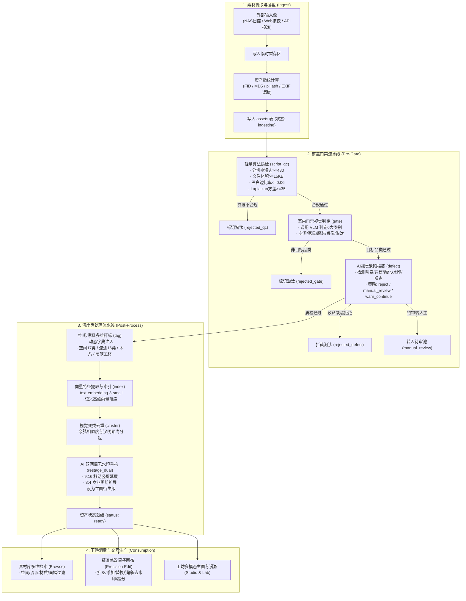

# 室内设计素材库系统 · 业务执行与系统治理全流程说明文档

> 本文档面向素材库系统管理人员与工程技术团队，全面梳理了**业务执行全生命周期流程**（从一张素材进入系统的全流转过程）以及**管理控制台治理流程**（供应商、模型契约、提示词资产、模块化工作流的具体操作手册）。

---

## 目录

- [第一篇：素材生命周期流转流程（业务执行全流程）](#第一篇素材生命周期流转流程业务执行全流程)
  - [1.1 执行流程全局架构图](#11-执行流程全局架构图)
  - [1.2 Step 1：素材接入与摄取（Ingest / Drop / Upload）](#12-step-1素材接入与摄取ingest--drop--upload)
  - [1.3 Step 2：入库前置门禁流水线（Ingest Pre-Gate Pipeline）](#13-step-2入库前置门禁流水线ingest-pre-gate-pipeline)
  - [1.4 Step 3：入库沉淀与深度后处理流水线（Ingest Post-Process Pipeline）](#14-step-3入库沉淀与深度后处理流水线ingest-post-process-pipeline)
  - [1.5 Step 4：运行态异常监控与人工复核（Runs & Exceptions）](#15-step-4运行态异常监控与人工复核runs--exceptions)
  - [1.6 Step 5：业务下游消费与交互式生产（Client Consumption）](#16-step-5业务下游消费与交互式生产client-consumption)
- [第二篇：管理控制台系统治理操作手册（管理流程实操）](#第二篇管理控制台系统治理操作手册管理流程实操)
  - [2.1 控制台进入与导航概览](#21-控制台进入与导航概览)
  - [2.2 一、接入点与供应商池管理（Providers Hub）](#22-一接入点与供应商池管理providers-hub)
  - [2.3 二、模型契约治理（Models Hub）](#23-二模型契约治理models-hub)
  - [2.4 三、提示词资产中心（Prompts Center）](#24-三提示词资产中心prompts-center)
  - [2.5 四、模块化工作流与挂载点编排（Workflows Hub）](#25-四模块化工作流与挂载点编排workflows-hub)
- [第三篇：系统运维、安全隔离与最佳实践](#第三篇系统运维安全隔离与最佳实践)
  - [3.1 密钥安全与三不原则](#31-密钥安全与三不原则)
  - [3.2 服务保活与平滑重载机制](#32-服务保活与平滑重载机制)

---

# 第一篇：素材生命周期流转流程（业务执行全流程）

## 1.1 执行流程全局架构图



---

## 1.2 Step 1：素材接入与摄取（Ingest / Drop / Upload）

一张图片进入系统，首先触发摄取层：
1. **输入通道支持**：
   - **自动化目录监听（NAS Ingest）**：后台定时扫描设定的素材监控目录（如未分拣的下载目录或网盘同步文件夹）。
   - **Web 前端交互上传**：管理员在管理界面的「素材库」点击批量上传按钮，支持文件拖拽或多选上传。
   - **OpenAPI 接口投递**：上游业务系统通过 `POST /api/ingest` 直接推送二进制图像流或 DataURL。
2. **底层数据动作**：
   - 系统将原始图片安全存储到本地数据仓储区（`originals/`）。
   - 生成系统唯一资产标识码 **`fid`**（如 `asset_1792200153554`）。
   - 提取基础物理元数据：图像宽度（`width`）、高度（`height`）、格式类型（`mime`）、文件大小。
   - 计算感知哈希 **`pHash`** 与内容 **MD5** 哈希指纹，用于后续的即时去重校验。
   - 在数据库 `assets` 表中初始化记录，初始生命周期标记为 `ingesting`（处理中）。

---

## 1.3 Step 2：入库前置门禁流水线（Ingest Pre-Gate Pipeline）

素材入库必须首先经过严密的前置三道关卡，阻绝低质、破损、无关内容进入系统：

### 关卡一：前置轻量算法质检（`script_qc` 模块）
- **核心定位**：纯本地 CPU 高速算法过滤，不消耗任何外部大模型 Token。
- **判断标准**：
  1. **短边尺寸（minShortSide）**：短边必须 $\ge 480\text{ px}$，低于该分辨率判定为低清废图。
  2. **文件体积（minBytes）**：文件体积必须 $\ge 15\text{ KB}$，杜绝空图与损坏碎图。
  3. **黑白边比率（barRatio）**：画面边缘黑边/白边占总画面比例不得超过 $0.06$（6%），防止带大面积非内容衬底的截图混入。
  4. **拉普拉斯方差清晰度（minLaplacianVar）**：计算图像边缘梯度方差，清晰度必须 $\ge 35$，过滤极度模糊失焦的图像。
- **处理结果**：未达标者直接标记 `rejected_qc` 移入淘汰库，流程中止。

### 关卡二：室内门禁视觉判定（`gate` 模块）
- **核心定位**：多模态视觉大模型（VLM）智能分类，基于 673 字符出厂黄金判定准则。
- **分类与判定规则**：
  - **`interior`（室内空间）**：客厅、卧室、餐厅、厨房、卫浴、书房、阳台、商业空间等室内全景或效果图。
  - **`furniture`（家具单品）**：家具、灯具、软装单品，需能看成独立物件。
  - **`clothing`（服装穿搭）**：服装单品、模特穿搭展示。**【重要互斥】**：只要主要展示衣服穿搭，或人脸不可见、头部截去、背影无清晰五官，**严禁归入肖像，必须归入服装**！
  - **`portrait`（虚拟人像与人物肖像）**：主体必须是人物本身，且**必须具有清晰可见、完整露出的真实或虚拟五官人脸**。
  - **`none`（淘汰类别）**：聊天记录、美食、表情包、纯文字海报、无关杂物等。
- **处理结果**：若判定为 `none` 或 `is_material === false`，系统自动将资产状态更新为 `rejected_gate`，阻断后续昂贵的生成与重构链路。

### 关卡三：AI 视觉缺陷质检拦截（`defect` 模块）
- **核心定位**：专用于拦截 AI 生成或网络采集中的致命视觉硬伤。
- **质检五大核心维度**：
  1. **畸变穿模**：家具结构违反物理常识（悬浮、穿模、怪异透视断裂、肢体融化）。
  2. **边框色块**：画面边缘明显的非内容性黑白衬底或多余框线。
  3. **质感崩塌**：大面积塑料感涂抹、噪点、马赛克及黑帧死黑。
  4. **杂质残留**：显眼的多余浮水印、乱码文字、无意义签名或伪造 UI 元素。
  5. **光影极度失真**：严重过曝、死黑或死板生硬。
- **容错策略（Fallback Strategy）**：
  - `reject`：存在缺陷直接标记 `rejected_defect` 阻断入库。
  - `manual_review`：将资产标记为待审状态，自动流转至管理员的人工待审池。
  - `warn_continue`：记录缺陷标签并告警放行，允许进入下一阶段。

---

## 1.4 Step 3：入库沉淀与深度后处理流水线（Ingest Post-Process Pipeline）

通过前置门禁的优质素材，正式进入系统的核心知识构建与资产衍生阶段：

### 1. 空间与家具多维智能打标（`tag` / `tag_space` / `tag_furniture`）
- **室内空间多维打标（2242 字符动态词典规则）**：
  - **场景空间（`space`）**：严格单选，覆盖 17 种标准空间（如 `living_room` 客厅、`bedroom` 卧室、`porch` 门外门廊、`foyer` 门内门厅等）。
  - **流派风格（`style_main`）**：0~3 个数组，严格遵循 16 种国际与东方设计流派判据（法式=护墙板/线脚/人字拼；意式=大理石皮革低矮雕塑感；奶油风=无符号浅暖软融；中古风=1945-75柚木细锥腿；现代极简=冷感几何留白；宋式美学=雅素文人；新中式=传统符号现代转译；侘寂=斑驳枯寂等；严禁欧式轻奢、原木日式等非标准标签）。
  - **木系质感（`wood_style`）**：浅木、深木、做旧木、原木等，结合裂痕/包浆/磨损真实度判定。
  - **硬装主材（`materials_hard`）**：微水泥、大理石、洞石、瓷砖、木作、黑钛金属、岩板等（最多2个，禁止普通大白墙标乳胶漆）。
  - **软装主材（`materials_soft`）**：真皮、棉麻、天鹅绒、羊羔绒、藤编等（最多2个）。
- **高端家具买手鉴定打标（`tag_furniture`）**：
  - 针对家具单品，智能鉴定核心品类、饰面工艺（拉扣/拼花/擦色/拉丝）、造型特征（悬挑/异形/高背）、经典名品款名（如巴塞罗那椅、伊姆斯躺椅等）以及推荐适用空间。

### 2. 向量特征提取与检索索引（`index`）
- 节点调用语义嵌入大模型（`text-embedding-3-small`）。
- 将该素材的空间类型、流派、木系、主材、打标描述以及视觉摘要组装为密集文本，生成高维特征向量。
- 写入 SQLite 向量索引表，支撑毫秒级的**以文搜图、以图搜图、多条件自然语言模糊匹配**。

### 3. 视觉聚类与空间归组（`cluster`）
- 基于图像感知哈希（pHash）与特征向量距离，自动比对素材库已有资产。
- 将同一套室内案例的不同机位特写、同一房间的多角度实拍自动归纳聚合到同一空间簇（Cluster），方便下游整套成套调用。

### 4. AI 双画幅 3:4 & 9:16 无水印重构（`restage_dual`）
- **核心定位**：解决网络素材画幅混乱、带顽固水印的问题，产出商业级成品。
- **执行逻辑**：
  - 挂载 `restage_interior_9_16`（空间 9:16 纵深延展）与 `restage_interior_3_4`（空间 3:4 左右扩展）提示词基线。
  - 结合 `restage_negative` 负向约束（彻底剔除黑白边、模糊带、文字、logo）。
  - 采用图生图模型向外自然补全空间天花、地面与墙面，生成分辨率为 1080p 或 2K 的纯净高清画面。
  - 生成的重构图自动注册为资产的衍生版（Derivative），并**自动设为主图展示**。

### 5. 状态就绪（Status: `ready`）
- 完成全部流水线后，资产在数据库中正式标记为 `ready`，即刻在素材库大盘和检索端对外展现。

---

## 1.5 Step 4：运行态异常监控与人工复核（Runs & Exceptions）

系统对整个流水线具备完整的可观测性与异常自愈设计：
1. **异常隔离机制**：
   - 任何因网络超时、并发限流（HTTP 429）、鉴权失效（401）或模型服务商宕机导致的单步异常，均被捕获并记录在 `node_runs` 表中，不影响整库其他批次的运行。
2. **人工待审池流转**：
   - 质检策略触发 `manual_review` 的素材自动汇集在「运行与异常」界面的待审列表，管理员可查看该素材的具体质检扣分项与机器意见，一键执行**“通过放行”**或**“直接淘汰”**。
3. **单次拆盒与单节点重试（Unpack Run & Retry）**：
   - 管理员在控制台可调出任何一次批次运行的执行拓扑图，查看每个节点的实际输入、输出与耗时。
   - 针对单个失败节点，支持一键单独触发该节点的“局部重跑（Retry Node）”，无需重跑全流程，保证历史版本数据稳定。

---

## 1.6 Step 5：业务下游消费与交互式生产（Client Consumption）

入库就绪的高品质素材，将无缝流转进入下游各大生产力场景：
1. **素材库检索（Browse）**：
   - 用户可通过左侧空间树、流派标签、主材芯片、色板拾取器以及 9:16 / 3:4 比例筛选瞬间定位理想素材。
2. **精准修改算子画布（Precision Edit）**：
   - 用户在画布端圈选区域，直接调用 **8 大工业级精准修改算子**：
     - **智能扩图（Outpaint）**：四向自由延展，按指定比例（16:9, 9:16, 3:4）补全视野。
     - **局部添加（Insert）**：二维单品图通过边缘泛洪抠底后仿射贴入场景，自动表面吸附与环境光影融合。
     - **精准替换（Replace）**：基于 3D 模型固定机位与朝向角度（Yaw），将旧家具替换为新家具，保持地面透视与接触阴影。
     - **智能消除（Remove）**：选区内杂物擦除，自动根据周围环境纹理无痕修补。
     - **去水印净化（Clean）**：字幕、台标、水印秒级消除。
     - **智能留白（Space）**：推开两侧家具，腾出过道并延展地面纹理。
     - **全空间风格重塑（Style Transfer）**：保持房间几何与层高门窗不变，系统级重塑全屋软装材质。
     - **超分高清增强（Upscale）**：微观毛孔与纤维细节重建，提升至商业实景大片画质。
3. **多模态工坊与试验场（Studio & Lab）**：
   - 基于入库素材触发文生图、图生图、全景漫游视频渲染以及场景智能配乐。

---

# 第二篇：管理控制台系统治理操作手册（管理流程实操）

本篇详细说明作为系统管理员，如何对**供应商、模型契约、提示词资产、模块化工作流**进行全方位的增删改查与精细调优。

## 2.1 控制台进入与导航概览

1. 打开浏览器，访问控制台地址：`http://localhost:30001`（或部署域名的对应端口）。
2. 在左侧深色全局导航栏中，点击图标为 `smart_toy` 的 **「模型」** 菜单项（路径为 `/#/models`）。
3. 页面顶部将呈现四大核心治理中心的标签栏：
   - **[ 供应商管理 ]**：底层模型接口、BaseURL、多凭证轮换池管理。
   - **[ 模型契约 ]**：全模态模型能力注册、参数映射与专属优化器技能。
   - **[ 提示词中心 ]**：全系统提示词一等公民资产库（带版本控制与官方基线）。
   - **[ 模块化工作流 ]**：挂载点流水线管线编排与深度业务超参配置。

---

## 2.2 一、接入点与供应商池管理（Providers Hub）

本模块用于管理底层模型服务的 API 物理接入点、鉴权协议与密钥安全轮换。

```
[ 模型中心: 供应商管理界面 ]
┌────────────────────────────────────────────────────────────────────────┐
│ [供应商管理 (当前)]  [模型契约]  [提示词中心 (18)]  [模块化工作流 (4)]   │
├────────────────────────────────────────────────────────────────────────┤
│ 接入点与供应商池                                          [+ 新建接入点] │
│ 配置 BaseURL、协议、鉴权、请求头与多密钥轮换池                           │
├────────────────────────────────────────────────────────────────────────┤
│ ┌────────────────────────────────────────────────────────────────────┐ │
│ │ 火山方舟大模型服务池 (ark)   [Bearer Token] [已启用]               │ │
│ │ https://ark.cn-beijing.volces.com/api/v3                           │ │
│ │                                  [编辑] [删除] [停用] [能力与密钥] │ │
│ └────────────────────────────────────────────────────────────────────┘ │
└────────────────────────────────────────────────────────────────────────┘
```

### 1. 查看与检索接入点（Read）
- 点击顶部的 **「供应商管理」** 标签。
- 页面以卡片列表形式展示所有接入点，直观显示其：
  - **接入点名称**（如“火山方舟大模型服务池”、“Agnes 国内高速通道”）。
  - **唯一 ID**（如 `ark`、`agnes`）。
  - **协议类型**（`Bearer Token` / `AK/SK 签名` / `无鉴权`）。
  - **在线状态**（绿底“已启用”或灰底“已停用”）。
  - **BaseURL 地址**。

### 2. 新建接入点（Create）
- **点击位置**：右上角蓝色按钮 **「+ 新建接入点」**。
- **弹窗填写步骤**：
  1. **接入点 ID**：输入英文标识（如 `custom_openai`），保存后不可修改。
  2. **显示名称**：输入可读中文名（如 `深度推理专线`）。
  3. **BaseURL**：输入接口根地址（如 `https://api.your-gateway.com/v1`）。
  4. **鉴权协议**：下拉选择鉴权模式：
     - `Bearer Token`（常用，走 HTTP Authorization 请求头）
     - `AK/SK 签名`（用于火山引擎、AWS 等防篡改签名）
     - `无鉴权`（用于本地局域网算法、免密中转）
  5. **凭证池配置**：
     - 在文本框中输入环境变量名或密钥槽位，支持配置多个 Key 用英文逗号分隔（如 `KEY_SLOT_1, KEY_SLOT_2`）。
     - 系统自动轮换请求，杜绝单 Key 频率超限。
  6. **状态开关**：勾选“启用该接入点”。
- **提交保存**：点击弹窗右下角 **「保存接入点」**，列表即刻刷新。

### 3. 查看详情与多密钥轮换池（Inspect Key Pool）
- **点击位置**：卡片右侧的 **「能力与密钥」** 按钮。
- **展开面板内容**：
  - **挂接能力（Capabilities）**：展示该接入点承载的具体能力路径（如 `ark_image` 生图、`litellm_chat` 对话等）。
  - **凭证轮换池（Slot 列表）**：
    - 清晰列出每个密钥槽位（Slot 1, Slot 2, Slot 3）。
    - **安全脱敏显示**：显示掩码 `••••••••50Mc`、尾号 `50Mc`、以及 SHA-256 哈希指纹 `4ae3639e`。
    - **状态标识**：绿色勾选“就绪”，表明该密钥已成功装载且在服务端内存中待命。

### 4. 编辑接入点（Update）
- **点击位置**：卡片右侧 **「编辑」** 按钮。
- 在弹出窗口中，可以修改 BaseURL 地址、鉴权协议、追加新的密钥槽位。
- 点击 **「保存接入点」** 生效。

### 5. 一键启用 / 停用（Toggle）
- **点击位置**：卡片右侧的 **「启用」/「停用」** 快捷按钮。
- 点击后立即生效：停用状态的接入点在调度器分配流量时会被完全跳过，避免向故障服务商发送请求。

### 6. 删除接入点与级联保护（Delete）
- **点击位置**：卡片右侧红色 **「删除」** 按钮。
- **安全级联拦截**：
  - 如果系统中仍有模型契约正依赖该接入点（例如仍有 `seedream5flash` 绑定在 `ark` 接入点），系统会自动弹出安全拦截警告：
    > *“无法删除接入点 ark：仍有 4 个模型契约正在使用 (Seedream 5.0 Flash, Seedream 5.0 Pro...)，请先解除绑定。”*
  - 只有在解绑所有依赖模型后，方可成功删除，确保系统运行时永远不出现空指针断流。

---

## 2.3 二、模型契约治理（Models Hub）

本模块用于统筹管理全系统的多模态模型契约、厂商底层模型对齐、参数换算规范以及专属的提示词优化器（Skill）。

```
[ 模型中心: 模型契约界面 ]
┌────────────────────────────────────────────────────────────────────────┐
│ [供应商管理]  [模型契约 (当前)]  [提示词中心 (18)]  [模块化工作流 (4)]   │
├────────────────────────────────────────────────────────────────────────┤
│ 模型契约治理                                            [+ 新建模型契约] │
│ 管理文本、视觉、生图、生视等全模态模型契约，配置参数映射与专属优化技能 │
├────────────────────────────────────────────────────────────────────────┤
│ ▼ 生图 模型 (8)                                                        │
│ ┌──────────────────────┐  ┌──────────────────────┐                     │
│ │ Seedream 5.0 Pro     │  │ Agnes Image 2.5      │  ...                │
│ │ doubao-seedream-5-0  │  │ agnes-image-2.5      │                     │
│ │ [编辑契约] [删除]    │  │ [编辑契约] [删除]    │                     │
│ └──────────────────────┘  └──────────────────────┘                     │
│ ▼ 文本/视觉 模型 (13)                                                  │
│   ...                                                                  │
└────────────────────────────────────────────────────────────────────────┘
```

### 1. 分模态契约总览（Read）
- 点击顶部的 **「模型契约」** 标签。
- 页面将契约模型按功能领域自动分块呈现：
  - **生图模型**（`Seedream 5.0 Pro`, `Seedream 5.0 Flash`, `Agnes Image` 等）
  - **生视频模型**（`Seedream Video`, `SeaDance` 等）
  - **生音频模型**（`Doubao Music` 等）
  - **文本/视觉对话模型**（`Agnes 3.0 Flash`, `Gemma-4`, `Gemini Flash` 等 13 个 LiteLLM 契约）
- 卡片直观标明模型 ID、厂商物理模型标识（`vendor_model_id`）、挂接能力以及参数契约数量。

### 2. 新建模型契约（Create）
- **点击位置**：右上角蓝色按钮 **「+ 新建模型契约」**。
- **弹窗填写步骤**：
  1. **模型 ID**：系统的内部统一代号（如 `sdxl_turbo`）。
  2. **显示名**：界面呈现名称（如 `SDXL 极速生成`）。
  3. **厂商模型 ID**：向上游服务商 API 实际传递的 `model` 字段名称（如 `stabilityai/sdxl-turbo`）。
  4. **挂载接入点能力**：下拉选择所属的接入点能力（如 `ark_image`、`litellm_chat`）。
- 点击 **「保存模型契约」**。

### 3. 编辑契约参数与超参换算（Update Parameters）
- **点击位置**：模型卡片上的 **「编辑契约」** 按钮。
- **参数契约微调**：
  - 查看和配置各参数换算表（如 `size` 比例到像素矩阵换算、`negative_prompt` 传递方式）。
  - **火山方舟规范化自动封装**：针对 Seedream 等模型，若优化模式设为 `off`，系统底层自动剔除 `optimize_prompt_options` 字段；设为 `standard` 时规范打包传递。

### 4. 专属提示词优化器 Skill 管理与恢复默认（Optimizer Skill）
- 在模型契约编辑弹窗中部，展示该模型的 **「专属优化器 Skill（Prompt Optimizer）」** 配置区：
  1. **执行优化的对话大模型**：下拉选择用于执行改写的 LLM（如 `Agnes 3.0 Flash`）。
  2. **专属优化提示词正文（Prompt Textarea）**：
     - 支持多行编辑专为该模型量身定制的改写指令（如强调透视灭点、硬装大理石与微水泥真实质感、机位景深等）。
  3. **一键恢复官方默认（Restore Official）**：
     - 若该模型拥有出厂官方调优指南，右上角会出现蓝色的 **「恢复官方默认」** 按钮。
     - 点击后立即一键将当前正文重置回出厂官方黄金基线，防止参数调乱。

### 5. 优化器即时试跑 Playground（Live Test Run）
- **核心价值**：无需点击保存、无需真实提交出图，即可在当前界面验证提示词优化效果！
- **操作步骤**：
  1. 在弹窗下方的“优化器即时试跑 Playground”输入框中，输入一段简短的原提示词（如：`现代极简客厅，皮质沙发`）。
  2. 点击 **「测试改写」** 按钮。
  3. 系统将即时抓取当前多行文本框中**尚未保存的草稿 Skill**，调用后台大模型改写。
  4. 几秒内下方绿色边框区域即可输出完整的摄影级专业室内设计效果图改写文本，所见即所得。

### 6. 删除模型契约（Delete）
- **点击位置**：模型卡片右下角垃圾桶图标，或编辑弹窗左下角的红色 **「删除模型契约」** 按钮。
- 确认后即可彻底注销该契约，该模型将自动从工坊和工作流下拉列表中移除。

---

## 2.4 三、提示词资产中心（Prompts Center）

本模块是全系统所有提示词的一等公民资产管理库，提供分类检索、动态变量插槽编辑、版本追踪与官方黄金基线恢复。

```
[ 模型中心: 提示词资产中心界面 ]
┌────────────────────────────────────────────────────────────────────────┐
│ [供应商管理]  [模型契约]  [提示词中心 (18 当前)]  [模块化工作流 (4)]   │
├────────────────────────────────────────────────────────────────────────┤
│ 提示词资产中心                                          [+ 新建提示词] │
│ 全系统提示词独立第一公民资产。支持 n8n 风格变量插槽引用与官方基线回滚 │
├────────────────────────────────────────────────────────────────────────┤
│ [全部 (18)] [门禁初筛 (4)] [缺陷质检 (1)] [空间打标 (2)] [画幅重构 (5)]│
├────────────────────────────────────────────────────────────────────────┤
│ ┌────────────────────────────────────────────────────────────────────┐ │
│ │ AI 视觉缺陷质检拦截 (defect_inspection) · v1           [官方基线]  │ │
│ │ ┌────────────────────────────────────────────────────────────────┐ │ │
│ │ │ 你是素材库 AI 视觉缺陷与画质质检员。针对输入的室内空间图像... │ │ │
│ │ └────────────────────────────────────────────────────────────────┘ │ │
│ │ 843 字符                              [恢复官方默认] [编辑正文] [删除] │ │
│ └────────────────────────────────────────────────────────────────────┘ │
└────────────────────────────────────────────────────────────────────────┘
```

### 1. 分类快速检索（Filter）
- 点击顶部的 **「提示词中心」** 标签。
- 点击分类切换按钮，瞬间定位资产：
  - **全部**（全量 18 套提示词资产）
  - **门禁初筛**（室内门禁 `gate_interior`、家具门禁 `gate_furniture`、服装门禁 `gate_clothing`、人像门禁 `gate_portrait`）
  - **缺陷质检**（AI 视觉缺陷拦截 `defect_inspection`）
  - **空间与家具打标**（室内空间多维打标 `tag_space_interior`、高端家具鉴定打标 `tag_furniture`）
  - **画幅重构**（空间9:16重构 `restage_interior_9_16`、空间3:4重构 `restage_interior_3_4`、家具9:16重构 `restage_furniture_9_16`、家具3:4重构 `restage_furniture_3_4`、重构负向提示词 `restage_negative`）
  - **精准修改算子**（精准替换 `prec_replace_ark`、局部安装 `prec_insert`、智能消除 `prec_remove`、去水印 `prec_clean`、智能扩图 `prec_expand`、全空间风格重塑 `prec_style_transfer`、超分增强 `prec_upscale`）

### 2. 新建自定义提示词（Create）
- **点击位置**：右上角蓝色按钮 **「+ 新建提示词」**。
- **弹窗填写步骤**：
  1. **提示词 ID**：全局唯一英文字符（如 `prompt_custom_lighting`）。
  2. **显示名称**：中文名称（如 `夜景微光气氛重塑`）。
  3. **所属分类**：下拉选择所属业务大类。
  4. **提示词正文**：输入模板内容，可自由使用插槽。
- 点击 **「保存提示词」**。

### 3. 编辑提示词正文与快捷插入 n8n 变量插槽（Update & Interpolation Chips）
- **点击位置**：卡片右下角的 **「编辑正文」** 按钮。
- **弹窗高阶特性：快捷变量芯片（Variable Chips）**：
  - 编辑框上方提供丰富的**可交互变量芯片**，点击即可在当前光标位置无缝注入：
    - `{{$node["gate"].category}}`：前序门禁节点的判定分类
    - `{{$node["gate"].reason}}`：门禁判定的具体事实原因
    - `{{$node["defect"].defect_type}}`：前序缺陷拦截的类型（`distortion`, `bars`, `watermark` 等）
    - `{{$node["tag"].space}}`：打标节点输出的空间主分类（客厅/卧室等）
    - `{{$node["tag"].style_main}}`：打标节点输出的流派风格标签
    - `{{asset.file_name}}`：当前素材的原始文件名
    - `{{asset.width}}` / `{{asset.height}}`：素材原始宽高尺寸
  - 运行时由调度引擎自动提取上游节点的输出结果动态替换，优雅实现跨节点动态上下文传递！
- **版本自增**：每次保存修改，系统自动累加版本号（如 `v1` $\to$ `v2`），可追溯修改历史。

### 4. 一键恢复官方默认基线（Restore Baseline）
- **点击位置**：卡片下方的 **「恢复官方默认」** 链接。
- 系统弹出二次确认框，确认后系统自动将模板内容无痕重置回出厂预置的官方黄金准则。内置的 673 字室内门禁、2242 字多维打标字典规则均可一键归位。

### 5. 删除自定义提示词（Delete）
- 自定义提示词右下角提供红色 **「删除」** 按钮。官方内置的核心提示词受到系统写保护，不可误删。

---

## 2.5 四、模块化工作流与挂载点编排（Workflows Hub）

本模块是整个素材库最核心的编排大脑，实现了**业务流程与底层能力的完全解耦**。管理员可像使用 n8n / ComfyUI 一样自由组合挂载点、编排执行模块、微调执行顺序与超参数。

```
[ 模型中心: 模块化工作流界面 (IDE 左右分栏) ]
┌────────────────────────────────────────────────────────────────────────┐
│ [供应商管理]  [模型契约]  [提示词中心 (18)]  [模块化工作流 (4 当前)]   │
├────────────────────────────────────────────────────────────────────────┤
│ 模块化工作流与挂载点编排                               [+ 新建挂载点]  │
├──────────────────────────┬─────────────────────────────────────────────┤
│ 挂载点清单 (4 个)        │ 入库前置门禁流水线 (ingest_pre_gate)        │
│ ┌──────────────────────┐ │ 触发类型: event · 事件驱动   [测试执行] [+] │
│ │ 入库前置门禁流水线   │ ├─────────────────────────────────────────────┤
│ │ (ingest_pre_gate)    │ │ ① 前置轻量算法质检 [script_qc] [已启用]    │
│ │ 3 个模块      [内置] │ │   挂载模型: (本地算法) · 参数: barRatio=0.06│
│ ├──────────────────────┤ │   [↑] [↓] [配置] [删除]                     │
│ │ 入库后处理流水线     │ ├─────────────────────────────────────────────┤
│ │ (ingest_post_process)│ │ ② 室内门禁视觉判定 [gate]      [已启用]    │
│ │ 4 个模块      [内置] │ │   挂载模型: workflow_vision · 绑定: gate_int│
│ ├──────────────────────┤ │   [↑] [↓] [配置] [删除]                     │
│ │ 精准修改算子流水线   │ ├─────────────────────────────────────────────┤
│ │ (precision_edit)     │ │ ③ AI 视觉缺陷质检拦截 [defect] [已启用]    │
│ │ 6 个模块      [内置] │ │   挂载模型: workflow_vision · 绑定: defect_ │
│ ├──────────────────────┤ │   [↑] [↓] [配置] [删除]                     │
│ │ 生成工坊创意流水线   │ └─────────────────────────────────────────────┘ │
│ └──────────────────────┘                                               │
└──────────────────────────┴─────────────────────────────────────────────┘
```

### 1. 左右分栏工作台结构（Layout）
- 点击顶部的 **「模块化工作流」** 标签。
- 界面采用专业 IDE 式的左右分栏：
  - **左侧树形目录（4列宽）**：展示所有挂载点列表、触发类型徽标（`event`、`api`、`cron`、`manual`）、包含的模块计数与内置标记。
  - **右侧流水线管线（8列宽）**：纵向展开当前选中的挂载点所包含的具体执行模块列表。

### 2. 新建自定义挂载点（Create Mount Point）
- **点击位置**：右上角蓝色按钮 **「+ 新建自定义挂载点」**。
- **弹窗填写步骤**：
  1. **挂载点 ID**：唯一标识（如 `mp_nightly_batch`）。
  2. **显示名称**：业务名称（如 `深夜素材深度再标注流水线`）。
  3. **触发类型（Trigger Type）**：
     - `event`：资产落盘或状态改变时由系统事件自动触发。
     - `api`：由外部业务系统或前端画布通过 HTTP API 主动调用触发。
     - `cron`：定时任务跑批触发。
     - `manual`：仅允许管理员在后台点击“测试执行”手动触发。
  4. **描述说明**：简述该挂载点的用途与设计初衷。
- 点击 **「创建挂载点」**。

### 3. 向流水线添加执行模块（Add Module to Pipeline）
- **点击位置**：在右侧流水线头部点击蓝色 **「+ 添加模块」** 按钮。
- **弹窗配置项**：
  1. **模块名称**：如 `首道室内门禁初筛`。
  2. **节点类型（Node Type）**：下拉选择要运行的核心算法算子（如 `gate` 门禁、`defect` 质检、`tag` 打标、`restage_dual` 画幅重构、`edit_replace` 精准替换、`edit_insert` 局部安装等）。
  3. **挂载模型（Model）**：从已注册的模型契约中选择执行模型（如选择 `workflow_vision`，或选择“不挂载模型/使用本地算法”）。
  4. **绑定提示词（Prompt Template）**：直接从提示词资产中心下拉选择关联的提示词资产（如 `gate_interior`）。
- 点击 **「保存模块」**。

### 4. 调整执行先后顺序（Reorder Modules）
- 流水线严格按照从上到下的序号（① $\to$ ② $\to$ ③ ...）串行推进。
- 每个模块卡片右侧提供 **「↑ 上移」** 与 **「↓ 下移」** 按钮。
- 点击即可无缝调整模块执行的先后顺序（例如让轻量质检优先于大模型门禁执行），调度器即时生效。

### 5. 模块深度业务超参数配置（Configure Module Parameters）
- **点击位置**：模块卡片上的 **「配置」** 按钮。
- **深度配置弹窗内容**：
  1. **行内 Prompt 覆盖**：若特定业务需要临时覆盖提示词中心资产，可在此输入自定义覆盖文本，支持动态变量插槽。
  2. **高级业务控制超参数（Fine-grained Parameters）**：
     - **采样温度（`temperature`）**：浮点数调整，质检与门禁推荐 `0.1` 保证严密稳定；创意生成推荐 `0.7`。
     - **超时毫秒（`timeoutMs`）**：单步调用的硬超时底线（默认 `30000` ms）。
     - **失败降级策略（`fallbackStrategy`）**：
       - `reject`：直接拦截报错。
       - `manual_review`：自动移入人工待审池。
       - `warn_continue`：打标告警并放行后续流程。
     - **汉明距离阈值（`phashThreshold`）**：视觉去重灵敏度（默认 5~8）。
     - **黑白边比率（`barRatio`）**：边缘留白容差（默认 0.06）。
     - **清晰度方差（`minLaplacianVar`）**：虚焦检测阈值（默认 35）。
     - **算子专属参数**：
       - 精准替换（`edit_replace`）：贴回保护开关（`pasteback`）、朝向角度（`yaw`）、姿态（`pose`）、材质策略（`auto`/`color`/`ref`/`pick`）。
       - 局部安装（`edit_insert`）：安装模式（`installMode: B/C`）、表面吸附对齐策略。
       - 智能扩图（`edit_expand`）：四向外扩比例（`expandRatios`）、通道选择（即梦 Jimeng / veImageX / 模型适配器）。
- 点击 **「保存模块」**。

### 6. 流水线模拟测试执行（Test Execution / Dry Run）
- **点击位置**：右侧挂载点头部的 **「测试执行」** 按钮。
- **执行效果**：
  - 系统对当前挂载点发起离线模拟测试，按序执行所有模块的入参组装、模型契约可达性与提示词渲染校验。
  - 测试通过后，右上角弹出绿色通知：*“挂载点 ingest_pre_gate 测试执行成功 (3 个模块已按序校验)”*。

### 7. 实时双向图同步保证运行态零停机（Two-way Graph Sync）
- **核心机制**：
  - 管理员在挂载点中修改前置门禁或后处理流水线时，后台自动将最新模块流水线编译成图结构，并双向持久化写入 SQLite 的 `workflows WHERE id='default'`。
  - 后台常驻运行的无人值守调度器（`WorkflowInterpreter`）**即刻无缝读取最新配置**，新入库素材立即应用新规则，无需重启后端服务。

---

# 第三篇：系统运维、安全隔离与最佳实践

## 3.1 密钥安全与三不原则

本系统涉及大量外部第三方大模型厂商 API（火山方舟、Agnes、LiteLLM 等），系统严格执行以下**安全基线**：
1. **严禁明文入库**：数据库中仅保存环境变量名槽位映射或加密索引，不存储任何可读的 API Key 明文。
2. **严禁明文返回前端**：所有管理端接口（如 `GET /api/providers`）在序列化响应时，对所有凭证强制执行脱敏过滤，前端只能拿到脱敏掩码（如 `••••••••50Mc`）与 SHA-256 前 8 位防篡改指纹。
3. **严禁明文记录日志**：后端调试日志与异常跟踪堆栈中，通过正则拦截器自动脱敏所有形如 `sk-***`、`Bearer ***` 的敏感字符串。

---

## 3.2 服务保活与平滑重载机制

1. **核心服务端口**：
   - 端口 **`30001`**：素材库核心 API 服务兼前端 Web 静态资源托管服务。
   - 端口 **`30002`**：开发与热重载调试端口。
2. **看门狗（Watchdog）自动守护**：
   - 系统运行有独立的 Watchdog 守护进程（PID 文件位于 `~/.dsh-material-library/watchdog.pid`）。
   - 若主服务因异常崩溃，Watchdog 将在 3 秒内自动拉起新进程。
   - **平滑重启标准操作**：
     ```bash
     kill $(cat ~/.dsh-material-library/server.pid)
     ```
     执行上述命令后，Watchdog 将自动优雅重载主服务并加载最新的前端构建产物（`web/dist`）与数据库配置。
3. **健康检查探针**：
   - 命令行终端执行：
     ```bash
     curl -s http://127.0.0.1:30001/health
     ```
   - 正常响应将返回服务就绪状态与毫秒级时间戳：
     ```json
     {"ok": true, "service": "material-library", "ts": 1792200080269}
     ```

---

> 如在日常运维或业务编排中有进一步定制需求，可查阅项目代码仓库的 [`src/models-contract.js`](file:///mnt/c/Users/lrp/DevEcoStudioProjects/MaterialLibraryServer/src/models-contract.js) 与 [`web/src/views/ModelsView.vue`](file:///mnt/c/Users/lrp/DevEcoStudioProjects/MaterialLibraryServer/web/src/views/ModelsView.vue)。
